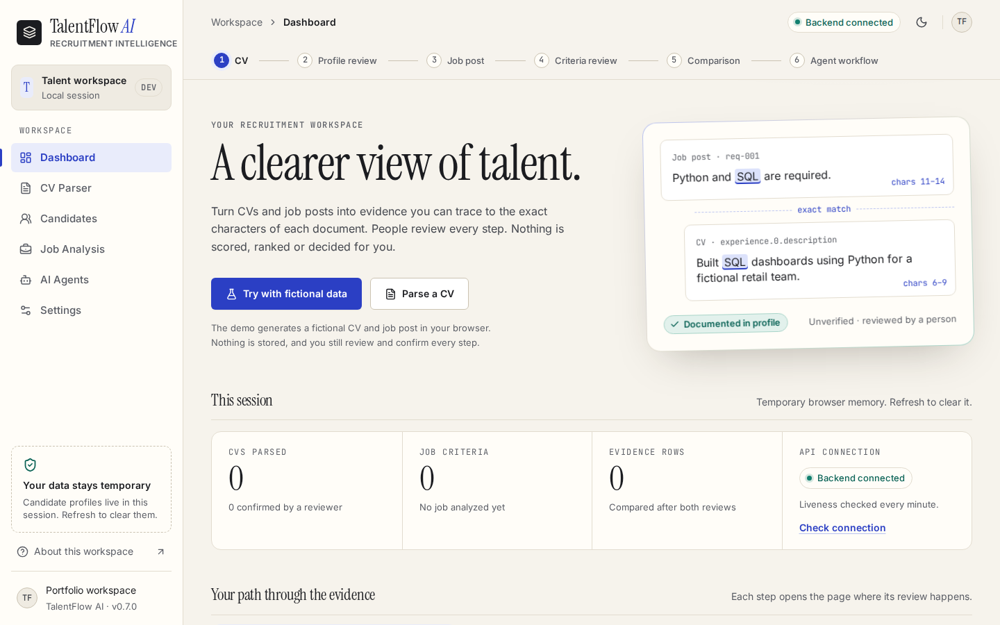
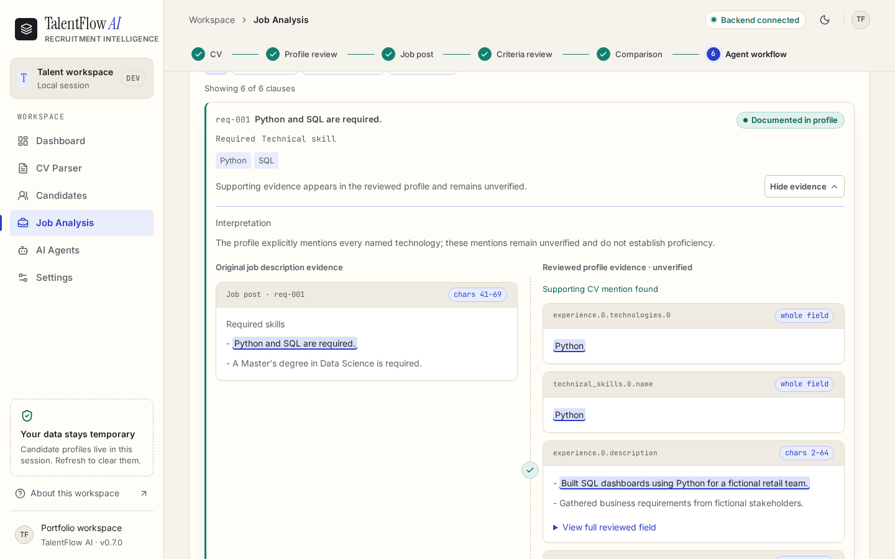
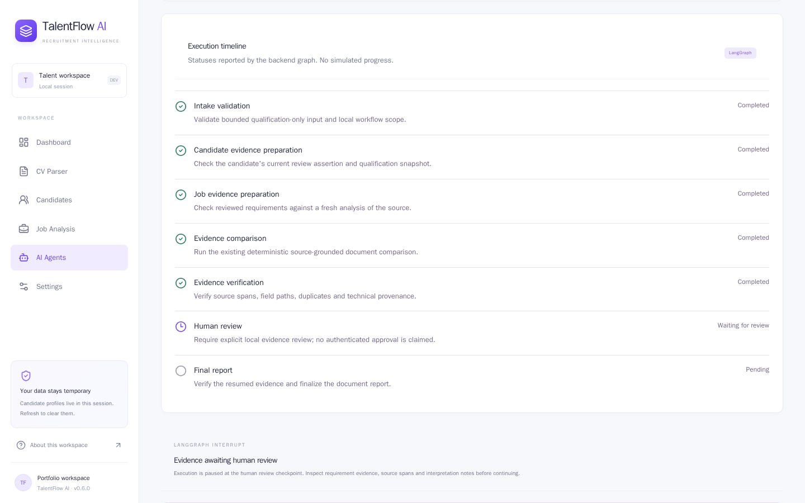
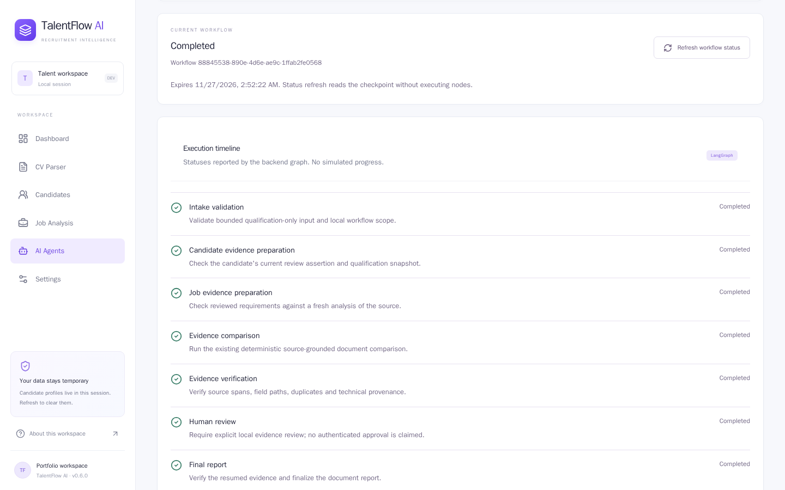
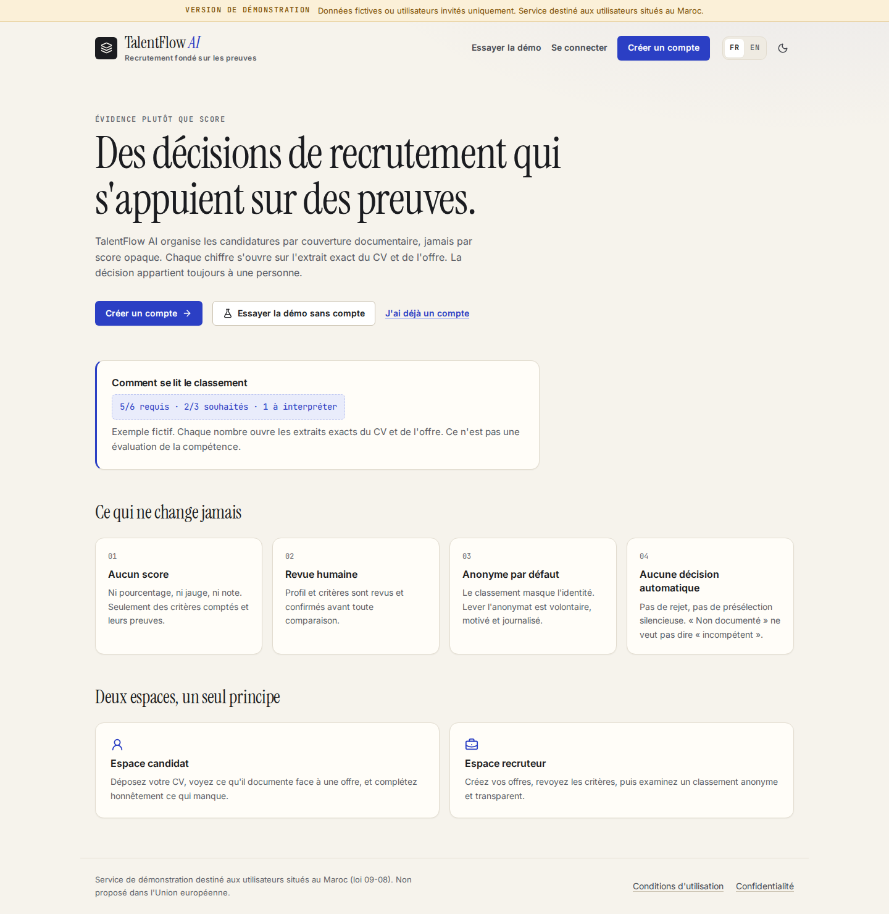
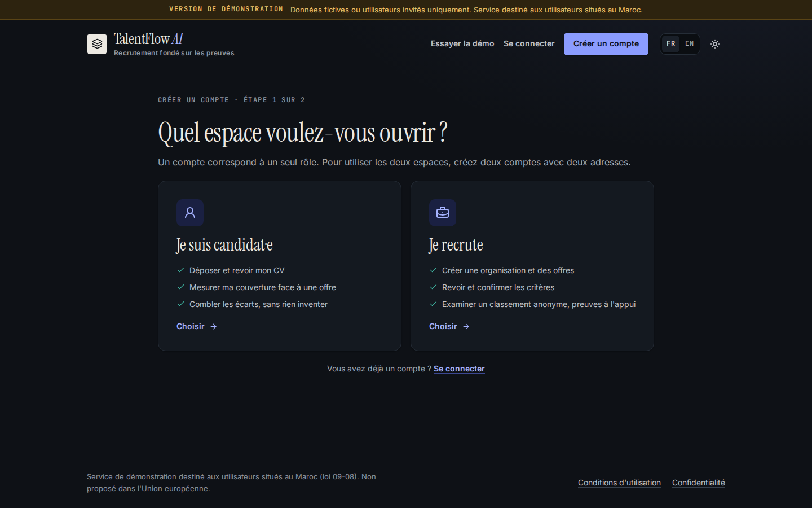
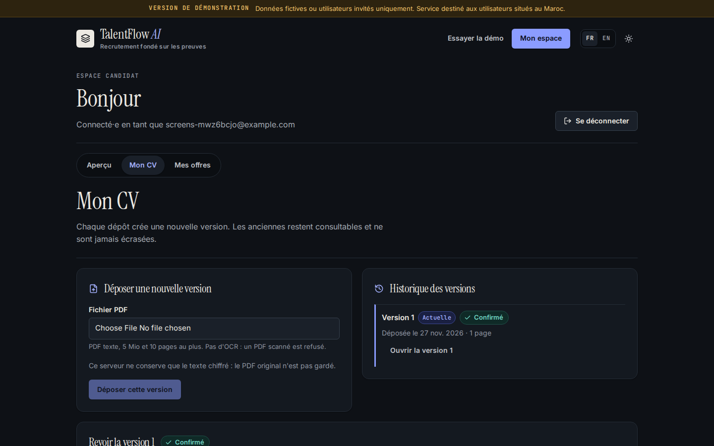
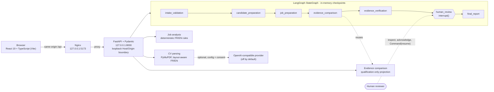

# TalentFlow AI

[](https://github.com/Firdaous24/talentflow-ai/actions/workflows/ci.yml)

**Evidence over scores: applications organised by documentary coverage, anonymous by default, where every number links to its proof and the decision stays human.**

## Why this project

Screening tools often reduce a person to an opaque match score. **TalentFlow AI organises applications by documentary coverage, never by an opaque score.** Every position is explained by counted criteria (“5/6 required · 2/3 preferred”) and every number opens on the exact excerpt of the CV and of the job post. The ordering is anonymous by default, does not measure real competence, and neither rejects nor accepts anyone: the decision always belongs to the recruiter. On the candidate side, the same transparency shows what a CV already documents, what is missing and what still needs interpretation, without ever inventing a skill.

Under the hood, it extracts what the documents actually say, links every statement to its exact source text, and marks each job requirement as *documented*, *not documented* or *needs human review*. There is no score, percentage or gauge, and nothing is decided automatically. A CV profile and the job requirements must both be reviewed and confirmed by a person before any comparison runs, the comparison only sees qualification fields (never identity, contact details, employers, locations or dates), and no external model is called without explicit configuration and per-upload consent. “Not documented” never means “not competent”.

The v1 platform is designed for users in **Morocco only** (law 09-08); any online instance is a demo with fictional data or invited users. The full design, privacy and ordering rules are in [docs/V1_DESIGN.md](docs/V1_DESIGN.md); the coverage-based ordering itself ships with the recruiter space (phase 8).

## Preview

All screenshots use fictional documents against the local stack. Light and dark themes are both supported.

| Dashboard with demo mode | Side-by-side evidence |
|---|---|
|  |  |
| **AI Agents — paused for human review** | **AI Agents — final report (dark theme)** |
|  |  |
| **Public home (French, demo warning)** | **Role choice at sign-up (dark theme)** |
|  |  |
| **Candidate space — documentary coverage** | **Candidate space — CV versions (dark theme)** |
|  |  |

## Architecture



Data flow: **PDF CV** → parsed profile with source evidence → human review and confirmation → **job description** → extracted requirements with exact offsets → human review → **evidence checklist**, either directly (`POST /api/v1/jobs/compare`) or through the LangGraph workflow, which pauses for an explicit review before its final report.

## Technical highlights

- **Source-grounded evidence.** Every job requirement and every CV excerpt carries its exact quote and `start`/`end` offsets in Unicode code points; the server re-checks them against a fresh analysis of the source before answering.
- **Qualification-only projection.** Comparisons accept education, experience descriptions, skills, projects, certifications and languages only; identity, contact, employer, location and date fields are rejected by the schema.
- **Real LangGraph interrupt/resume.** A seven-node `StateGraph` pauses at `interrupt()` and continues with `Command(resume=...)` after a human acknowledgment; evidence is verified again before the final report. No simulated progress.
- **No opaque scores, no automated decisions.** Three statuses only (`documented`, `not_documented`, `needs_review`), with explicit limitations attached to every result; no percentage, gauge or automatic rejection.
- **Accounts with roles (v0.8.0).** Candidate and recruiter accounts under `/api/v2`: argon2id passwords, server-side `HttpOnly` sessions, CSRF on every unsafe request, rate limits, versioned consents, account deletion and a pseudonymised append-only audit log in PostgreSQL. The `/api/v1` demo stays public and account-free.
- **Candidate space with encrypted CVs (v0.9.0).** Versioned CVs stored as AES-256-GCM ciphertext only, one data key per version wrapped by a master key from the environment (crypto-shredding on deletion); review, history and diff; private job posts, documentary coverage after both reviews, honest gaps, full export and deletion.
- **Local-first and private by default.** Loopback-only ports, Host/Origin checks on every API route, bounded request bodies, CVs never stored in clear (the original PDF is off by default), no external calls without consent; e-mails are captured locally by Mailpit.
- **Side-by-side evidence view.** The job clause and the CV excerpt sit next to each other, with the exact span highlighted from the API offsets and a `chars a–b` badge; “not documented” is shown as a neutral absence, never as a failure.
- **Tested end to end.** 849 backend tests (including reversible migrations, a generated authorization matrix and a check that no CV content is stored in clear), 109 frontend tests, 12 real-browser Chromium workflows, ruff and ESLint, strict TypeScript, and GitHub Actions CI with a PostgreSQL service on every push.

## Quick start

A `.env` file is **required**: it holds the database credentials, the secret used to sign sessions and CSRF tokens, and the master key that encrypts stored CVs. Never commit it.

```powershell
Copy-Item .env.example .env
# Generate the secret and set it as TALENTFLOW_SECRET_KEY in .env (at least 32 characters):
python -c "import secrets; print(secrets.token_urlsafe(48))"
# Generate the CV encryption master key and set it as TALENTFLOW_DATA_KEY in .env (32 bytes, base64url):
python -c "import secrets; print(secrets.token_urlsafe(32))"
# Keep SESSION_COOKIE_SECURE=false for local HTTP, and replace POSTGRES_PASSWORD.
docker compose up -d --build --wait
```

> [!WARNING]
> **Back up `TALENTFLOW_DATA_KEY` outside the repository** (for example in a password manager), separately from the database. **If it is lost, every stored CV becomes unreadable**: there is no recovery. If it leaks, treat it as compromised and rotate it.

The backend refuses a secret shorter than 32 characters or starting with `change-me`, and answers 503 `encryption_not_configured` on CV routes while `TALENTFLOW_DATA_KEY` is missing or a placeholder. Compose starts `db` (PostgreSQL), `migrate` (applies Alembic migrations, then exits), `backend`, `worker`, `mailpit` and `frontend`. Then open:

| URL | What |
|---|---|
| http://localhost:5173/welcome | Public home, sign-up and sign-in |
| http://localhost:5173 | Account-free demo workspace |
| http://localhost:8025 | Mailpit: verification and password e-mails are captured here, never sent out |
| http://127.0.0.1:8000/docs | API documentation |

On the Dashboard, **Try with fictional data** generates a fictional CV and a sample job post in the browser and walks you through the full flow in under a minute; the demo profile still requires your review and confirmation, and nothing is stored. See [Docker workflow](#docker-workflow-primary) for details and [Run tests on the host](#run-tests-on-the-host-optional) for local checks.

## Accounts and roles

Since v0.8.0 (phase 6 of the [v1 design](docs/V1_DESIGN.md)), people can open an account and choose its role at sign-up. One e-mail address has one role.

| Role | Space | Today |
|---|---|---|
| **Visitor** | Public home, demo, legal pages | Account-free demo at `/`, home at `/welcome`, permanent demo warning (Morocco only) |
| **Candidate** | Own data only | [Candidate space](#candidate-space): encrypted CV versions, review and diff, private job posts, coverage and gaps, consents, export, account deletion |
| **Recruiter** | Data of their organisations only | Minimal organisations (create, list, members), account deletion; job posts, imports and ordering arrive in phase 8 |

The flow is: role choice → sign-up (terms accepted, marketing never pre-ticked) → e-mail verification (link in Mailpit) → sign-in → own space → sign-out or account deletion (password required). Public pages and account spaces are in French by default with English available; the choice is stored only when you click a language.

Security in short: argon2id password hashing; a random session token whose SHA-256 alone is stored, in an `HttpOnly`, `SameSite=Lax` cookie (`Secure` and `__Host-` outside local HTTP), revoked at sign-out; a signed double-submit CSRF token on every unsafe request (403 `csrf_failed`); rate-limited sign-in, sign-up and e-mails; identical answers whether an address exists or not. Authorization is deny-by-default: no session → 401, another role's route → 403 `forbidden_role`, another organisation's resource → 404. A test generated from the OpenAPI schema fails if a new `/api/v2` route has no access policy. Deleting an account removes the user, sessions, tokens, consents and memberships, and leaves only a pseudonymised `account.deleted` audit entry; the audit log is append-only (PostgreSQL trigger) and kept 12 months.

Routes, error codes and the retention worker are documented in [docs/accounts_phase6.md](docs/accounts_phase6.md).

## Candidate space

Since v0.9.0 (phase 7), a signed-in candidate works in three tabs, **Aperçu**, **Mon CV** and **Mes offres**, following one ordered path: upload a CV → review and confirm it → paste a job post → review and confirm its criteria → read the documentary coverage and the gaps.

- **Encrypted storage.** Each upload adds a version and never overwrites an older one. Only ciphertext is stored: the extracted text, the parsing result and the reviewed profile, sealed with AES-256-GCM under a per-version data key that `TALENTFLOW_DATA_KEY` wraps. Deleting the key shreds the version everywhere, backups included. The original PDF is **not kept by default** (`CV_ORIGINAL_STORAGE=disabled`).
- **Review and history.** Only the current version is reviewed; any edit clears its confirmation. Older versions stay readable and locked, and two versions can be compared item by item.
- **Coverage.** Computed by the existing `compare_job` on the qualification-only projection, only after both reviews. It shows « x/y requis · a/b souhaités · n à interpréter », each number filtering the side-by-side evidence, under a permanent notice that it is not an assessment of ability.
- **Gaps.** Fixed sentences, such as « Si c'est vrai, ajoutez-le avec un exemple vérifiable », with a link to the matching CV section. Nothing is written in the candidate's place.
- **Your data.** A complete JSON export, recruiter visibility as a withdrawable opt-in, and account deletion that removes rows, keys and files.

Details, routes and the deviations from the design are in [docs/candidate_space_phase7.md](docs/candidate_space_phase7.md).

Release history and the validation recorded at each phase are in [docs/CHANGELOG.md](docs/CHANGELOG.md).

## Current status

**Current release: v0.9.0.** **Phases 1 through 7 are implemented:** backend foundation, Docker infrastructure, React workspace, layout-aware French/English CV parsing, source evidence, human review, deterministic job analysis and document comparison, technical-environment provenance, compact evidence results, source-bound excerpts, bounded LangGraph orchestration, (phase 6) mandatory PostgreSQL with accounts, roles and consents, and (phase 7) the candidate space with encrypted CV versions. Optional CV model extraction requires backend configuration and per-upload consent; job analysis and the graph require no AI credentials. Validation for each phase is recorded in the [changelog](docs/CHANGELOG.md).

Implemented:

- Modular, typed FastAPI backend, version `0.9.0`.
- Candidate space with encrypted, versioned CVs, private job posts, coverage, gaps and export (see [Candidate space](#candidate-space)).
- PostgreSQL (SQLAlchemy 2, psycopg 3) with reversible Alembic migrations, candidate and recruiter accounts under `/api/v2`, a retention worker and local e-mail capture with Mailpit (see [Accounts and roles](#accounts-and-roles)).
- Service information at `GET /` and liveness at `GET /api/v1/health`.
- Swagger documentation at `/docs` and OpenAPI schema at `/openapi.json`.
- Browser CORS access restricted to `http://localhost:5173` for GET and POST requests.
- PDF ingestion at `POST /api/v1/candidates/parse` (multipart field `file`).
- PyMuPDF structure checks, 5 MiB file limit, 10-page limit, and rejection of damaged, encrypted, and textless PDFs.
- Pydantic v2 candidate schemas and deterministic extraction with explicit warnings.
- Six fictional CV scenarios with PDFs generated in memory during tests.
- Automated endpoint, PDF service, extraction, schema, upload-limit, and CORS tests.
- Docker Compose workflow with a non-root backend, dedicated test image, and a required internal PostgreSQL service.
- Responsive React interface with Dashboard, CV Parser, Candidates, and application information pages.
- Layout-aware French/English section and entry extraction, expanded skill vocabulary and source evidence.
- In-memory corrections/removal and explicit reviewed-profile confirmation.
- Optional provider abstraction with structured outputs, evidence rejection and local fallback; no external calls without per-upload consent.
- Typed API client, local PDF validation, structured backend errors, extraction warnings, and temporary candidate profiles.
- Frontend production image with a same-origin Nginx API proxy and React Router fallback.
- French/English job analysis at `POST /api/v1/jobs/analyze`, qualification comparison at `POST /api/v1/jobs/compare`, and public limitations at `GET /api/v1/jobs/capabilities`.
- Reviewed original/corrected requirements, exact job excerpts, qualification-only candidate snapshots and in-memory evidence results at **Job Analysis** (`/matching`).
- Documented, not documented and needs review statuses with explanations; no candidate scores, rankings, eligibility decisions or hiring recommendations.
- Decorated multilingual job headings and slash/comma/pipe lists, distinct job-only technology aliases, source-bound location/contract/work-mode metadata and separate environment-only review states.
- Real seven-node LangGraph workflow, memory checkpoints, human interrupt/resume, source verification, session-scoped workflow access and an AI Agents workspace at `/agents`.

Planned:

- Candidate space with encrypted CV versions, coverage reports and gap analysis (phase 7), then the recruiter space with job posts, bulk import and anonymous coverage ordering (phase 8), pipeline and reports (phase 9), discovery (phase 10), compliance hardening and Arabic interface (phase 11). See [V1_DESIGN.md §9](docs/V1_DESIGN.md).
- Broader/complex CV layout support and OCR.
- Broader independent extraction/comparison holdouts.

The health endpoint checks application liveness only. CORS is a browser access policy, not authentication. Public deployment remains out of scope: any online instance is a demo.

In the `/api/v1` demo, candidate and requirement confirmations are **unverified client workflow assertions**, not authenticated approvals. The API checks current snapshots and original source evidence, but has no authenticated identity or durable review history. Agent workflows additionally require a random browser-session capability for every action; this is local scoping, not multi-user authentication. “Documented” means an unverified profile statement is present; “not documented” does not establish lack of ability. Final interpretation remains with a human.

## Technology stack

| Area | Technology | Status |
| --- | --- | --- |
| Backend | Python, FastAPI, Uvicorn | Implemented |
| Tests | pytest, httpx, FastAPI TestClient | Implemented |
| CV ingestion and schemas | PyMuPDF, python-multipart, Pydantic v2 | Implemented |
| AI orchestration | LangGraph 1.2.15 | Deterministic local evidence workflow with human interrupt/resume |
| Database | PostgreSQL 17, SQLAlchemy 2, psycopg 3, Alembic | Required; accounts, sessions, consents, organisations, audit log |
| Accounts | argon2-cffi, server-side sessions, signed CSRF, Mailpit (local e-mail) | Implemented under `/api/v2` |
| CV encryption | cryptography (AES-256-GCM envelope encryption) | Candidate CVs stored as ciphertext only |
| Frontend | React, TypeScript, Vite, Tailwind CSS, Lucide, React Router, i18next (FR/EN) | Implemented |
| Packaging | Docker, Docker Compose | Implemented |

## Project structure

```text
talentflow-ai/
├── backend/
│   ├── app/
│   │   ├── main.py              # FastAPI app, middlewares, routers, workflow lifespan
│   │   ├── api/
│   │   │   ├── local_boundary.py  # Loopback Host/Origin check and 1 MiB JSON limit on /api/v1 and /api/v2
│   │   │   ├── upload_limits.py   # 5 MiB multipart limit for CV uploads
│   │   │   ├── routes/            # /api/v1: health, candidates, jobs, agents
│   │   │   └── v2/                # /api/v2: auth, account, spaces, CSRF middleware
│   │   ├── auth/                # argon2id, tokens, CSRF, rate limiter, mailer
│   │   ├── core/config.py       # Settings from the environment (secret, database, cookies, e-mail)
│   │   ├── db/                  # SQLAlchemy models and sessions
│   │   ├── storage/             # Envelope encryption of stored CVs (crypto, cv, optional original files)
│   │   ├── worker.py            # Retention purges
│   │   ├── models/              # Pydantic contracts: candidate.py, job.py
│   │   ├── services/            # pdf, layout, sections, records, multilingual, extraction, llm (optional),
│   │   │                        # jobs, job_formatting, job_vocabulary
│   │   └── agents/              # LangGraph StateGraph, checkpoints, verification, boundary middleware
│   ├── migrations/              # Alembic (reversible migrations, tested in CI)
│   ├── tests/                   # pytest suites and fictional fixtures
│   ├── evaluate*.py             # Offline evaluation scripts (CV, jobs, comparison accuracy)
│   ├── requirements.txt / requirements.lock / requirements-dev.txt
│   ├── ruff.toml
│   └── Dockerfile               # base / test / runtime targets
├── frontend/
│   ├── src/
│   │   ├── App.tsx              # Layout, navigation and routes
│   │   ├── pages/               # Dashboard, Parser, Candidates, JobAnalysis, AIAgents, Settings, NotFound
│   │   ├── public/              # Public home, sign-up, sign-in, legal pages and account spaces
│   │   ├── auth/ · i18n/        # /api/v2 client and session context · FR/EN messages
│   │   ├── components/          # ReviewProfile, ComparisonResults, Profile, warnings, ConnectionBadge
│   │   ├── *Session.tsx         # In-memory session state (CV, job, agents)
│   │   ├── *Api.ts / api.ts     # Typed API clients
│   │   └── test/                # Vitest suites
│   ├── e2e/                     # Playwright Chromium scripts and image
│   ├── eslint.config.js
│   ├── nginx.conf
│   └── Dockerfile
├── docs/                        # Architecture notes, CHANGELOG, audit, screenshots (docs/images)
├── evaluation/                  # Recorded fictional evaluation results
├── .github/workflows/ci.yml     # Backend, frontend and Compose checks
├── docker-compose.yml           # db, migrate, backend, worker, mailpit, frontend
├── compose.dev.yaml / compose.test.yaml
├── .env.example
├── CLAUDE.md                    # Guide for coding agents
└── README.md
```

## Docker workflow (primary)

Install Docker Desktop for Windows with the WSL 2 backend, enable Linux containers, and start Docker Desktop. The workflow requires the Docker Compose plugin; host Python is unnecessary for container execution and testing. Run commands from `C:\Users\MSI\Desktop\talentflow-ai`.

Initial setup (copy the example only if `.env` does not already exist, then set `TALENTFLOW_SECRET_KEY` and `TALENTFLOW_DATA_KEY` as in the [Quick start](#quick-start)):

```powershell
Set-Location C:\Users\MSI\Desktop\talentflow-ai
docker --version
docker compose version
docker info
if (-not (Test-Path .env)) { Copy-Item .env.example .env }
docker compose config --quiet
docker compose up -d --build --wait
```

`.env` is required. The example supplies public local-development placeholders for `POSTGRES_DB`, `POSTGRES_USER` and `POSTGRES_PASSWORD` (replace the password), placeholders for `TALENTFLOW_SECRET_KEY` and `TALENTFLOW_DATA_KEY` that the backend refuses until you generate real ones, `CV_ORIGINAL_STORAGE=disabled`, and `SESSION_COOKIE_SECURE=false` for local HTTP only. Compose stops with an explicit error if a required value is missing. Keep `.env` out of Git; secrets go to containers at runtime, never into image contents. Avoid sharing full `docker compose config` output because it contains resolved passwords; use `--quiet` for validation.

Open **http://localhost:5173/welcome** for the public home, **http://localhost:5173** for the demo workspace, **http://localhost:8025** for Mailpit and **http://127.0.0.1:8000/docs** for Swagger. Initial image downloads/builds may take several minutes. HTTP services are published only on loopback (ports 5173, 8000 and 8025 must be free), and every `/api/v1` and `/api/v2` route rejects non-local `Host`/`Origin` headers.

PostgreSQL is required. The `migrate` service runs `alembic upgrade head` before the backend and worker start. The database is reachable from containers as `db:5432` and has no public port. The `postgres_data` volume is never removed by these commands.

Daily operations:

```powershell
docker compose ps
docker compose logs --tail 100 -f backend
docker compose logs --tail 100 db
docker compose stop
docker compose start
docker compose down
```

`stop` keeps containers and data; `down` removes project containers/network and preserves the database volume. Do not add `-v` for ordinary shutdown.

For source editing with reload, explicitly use the development override:

```powershell
docker compose -f docker-compose.yml -f compose.dev.yaml config --quiet
docker compose -f docker-compose.yml -f compose.dev.yaml up -d --build --wait
docker compose -f docker-compose.yml -f compose.dev.yaml logs -f backend
```

Only `backend/app` is mounted, read-only; edits made on the host are visible to Uvicorn. Dependencies remain inside the container. To switch back to the image's normal command, run `docker compose up -d --build --wait`. No automatic development override enables reload in the base configuration.

Build and run the full test suite inside the dedicated test image:

```powershell
docker compose -f docker-compose.yml -f compose.test.yaml build backend
docker compose -f docker-compose.yml -f compose.test.yaml run --rm backend
```

Tests run without host Python, a running API or external services. Database tests use the `test-db` service from `compose.test.yaml`, held in tmpfs and distinct from `postgres_data`. Rebuild the test image after source/test changes. Docker installs `requirements.txt` constrained by the Linux-resolved `requirements.lock`; the Python and PostgreSQL images are pinned by digest. For ordinary rebuilds:

```powershell
docker compose build backend
docker compose -f docker-compose.yml -f compose.test.yaml build backend
docker compose up -d --wait
```

Database persistence and reset: PostgreSQL data is held in the project-scoped `postgres_data` volume, normally named `talentflow-ai_postgres_data`. Initialization variables apply only to an empty volume; changing `.env` does not alter existing database credentials. Inspect project volumes with `docker volume ls --filter label=com.docker.compose.project=talentflow-ai`. After an explicit decision to discard all local database data and any necessary backup, the destructive reset command is `docker compose down --volumes`, followed by `docker compose up -d --wait`. This command is documented only; automated work must obtain explicit approval before running it. Never use a global prune to reset this project.

Troubleshooting: if Docker reports a daemon/named-pipe connection error, start Docker Desktop and verify Linux-container mode and daemon access. If ports 8000 or 5173 are occupied, stop the conflicting service or change its loopback host port. Use `docker compose ps` and service logs to diagnose unhealthy containers. Initial pulls/builds require internet access. Direct browser requests to the backend support CORS from `http://localhost:5173`; the default frontend uses its same-origin proxy.

The backend and frontend run as non-root users; no service is privileged, secrets are excluded from build contexts, and database ports are not published. Public deployment, managed secrets, TLS and worker isolation remain future work. See [Docker architecture](docs/docker_architecture.md).

After intentionally editing `backend/requirements.txt`, refresh the lock in a container before rebuilding normally. This explicit opt-out resolves dependencies without the old lock; leave the running service alone until the reviewed lock and final builds are ready:

```powershell
docker compose build --build-arg LOCK_FILE=/dev/null backend
$resolvedDependencies = docker compose run --rm --no-deps backend python -m pip freeze
if ($LASTEXITCODE -ne 0) { throw "Dependency lock generation failed" }
$resolvedDependencies | Set-Content -Encoding ascii backend/requirements.lock
git diff -- backend/requirements.txt backend/requirements.lock
```

Review the version changes, rebuild both runtime and test images normally, run containerized tests, then recreate the runtime service. Do not replace this Linux lock with a freeze of the Windows virtual environment. Digest pins must also be updated deliberately to receive base-image security fixes; version constraints are not artifact-hash verification.

## Frontend architecture and pages

The existing `frontend/` directory contains a React + TypeScript SPA built by Vite with Tailwind CSS and Lucide icons. `src/App.tsx` owns the shared sidebar/topbar and React Router routes; `pages/Parser.tsx` handles document selection and parsing; `components/Profile.tsx` renders the real candidate contract; `components/ErrorBoundary.tsx` provides recovery from rendering failures. `session.tsx` owns temporary profiles and periodic backend health checks. `types.ts` mirrors the Pydantic candidate and metadata models; `api.ts` handles requests, timeouts, PDF validation, and both structured document errors and FastAPI validation arrays.

**Design system.** All colours, type sizes, spacing, radii, shadows and durations are tokens in `src/theme/tokens.css` (warm-paper light theme, deep-slate dark theme, WCAG AA text contrast); no colour is hard-coded elsewhere. Fonts are self-hosted through `@fontsource` (Instrument Serif, Inter, JetBrains Mono); no CDN is used. Primitives live in `src/components/ui` (Button, Card, Badge, StatusPill, Stepper, EmptyState, Skeleton). The header carries a persistent workflow stepper derived from session state and a theme toggle that follows `prefers-color-scheme` until the user chooses. `prefers-reduced-motion` disables animations.

| Page | Current behavior |
| --- | --- |
| Dashboard | Product home: hero, fictional demo mode, live session state, six-step path, principles and recent activity |
| CV Parser | Select/drop one PDF, validate extension/MIME/header and 5 MiB size, submit, show fields and warnings, retry or upload another |
| Candidates | Successfully parsed profiles in memory, profile detail route, clear session profiles |
| Job Analysis | Select any session profile, confirm its review, analyze FR/EN text, review source-bound requirements and compare qualification evidence |
| AI Agents | Real deterministic LangGraph execution, actual checkpoint/review/resume, source-grounded report; no autonomous model agents |
| Settings | Actual application information, backend status and working health recheck |

The frontend calls `GET /api/v1/health`, `POST /api/v1/candidates/parse`, and `GET /api/v1/candidates/extraction-config` for public optional provider availability. The parse route remains compatible; optional form flags require explicit consent. Multipart requests use the field `file`, letting the browser set the boundary. `VITE_API_BASE_URL` is a build-time Vite variable; an empty value uses relative `/api/v1/...` paths. Vite proxies `/api` to `127.0.0.1:8000` during host development. The Docker frontend uses Nginx on port 8080 to proxy `/api/` to `backend:8000` and serve SPA routes; the browser sees only `localhost:5173`. Frontend startup waits for API health. The Node build stage is excluded from the lightweight non-root Nginx runtime image.

In the demo workbench, processing stays local: no CV file or profile is written to browser storage or a database (the candidate space stores CVs encrypted only, see [Candidate space](#candidate-space)). Optional model assistance transmits extracted text only after explicit per-upload consent to the displayed provider, whose retention policy applies. Successful candidate data is held in React memory until refresh/close or clearing the session. Raw uploaded file references are released after successful parsing. Do not put secrets in `VITE_*` variables: these values are public build output. The default Compose build explicitly uses the same-origin proxy; to change its base URL, change the frontend build argument and rebuild.

For optional host development, install Node 22.12+ (Node 22 LTS is used in Docker), start the backend, then:

```powershell
Set-Location frontend
npm ci
# Optional: copy .env.example to .env and set a public API base URL.
npm run dev
```

Open http://localhost:5173. The dev override `compose.dev.yaml` enables backend reload only; frontend changes require an image rebuild or the optional Vite development server.

## Frontend testing

With Node installed, run from `frontend/`:

```powershell
npm ci
npm test
npm run build
```

Without host Node, test the same source in Docker from the project root:

```powershell
docker build --target test -t talentflow-ai-frontend-test:local frontend
docker run --rm talentflow-ai-frontend-test:local
docker compose build frontend
```

Vitest + Testing Library cover PDF size/type/header validation, multipart API contracts, health, backend document/validation/network errors, timeout handling, upload/drop/loading/retry, profile sections and warnings, candidate session navigation/clearing, no persistent storage, and planned module labels. The production build compiles TypeScript with strict mode before bundling. Existing backend tests remain unchanged and are run separately using the commands below.

Manual browser checks: open Dashboard at desktop and mobile widths; check sidebar keyboard focus and mobile menu; upload a fictional text-based PDF; inspect all result sections and warnings; confirm reviewed corrections; open Job Analysis; paste a fictional job description, review requirements and compare evidence; refresh to verify profiles and results disappear. The application has no OCR, durable persistence, authentication or active agents. Default extraction is deterministic and partial; optional CV model extraction requires backend configuration and explicit consent. Backend health indicates liveness only.

Optional real Chromium smoke test (Docker Desktop, after Compose startup):

```powershell
docker build -t talentflow-ai-browser-test:local frontend/e2e
docker run --rm --ipc=host --add-host=host.docker.internal:host-gateway talentflow-ai-browser-test:local
```

This generates a fictional PDF in browser memory, uploads it to the real API through the frontend, checks profile sections/warnings and candidate navigation, then verifies route reload/session clearing, mobile navigation and invalid PDF handling. It defaults to `http://host.docker.internal:5173`, reaching the Docker Desktop host's published frontend. If host access is unavailable, use `--network talentflow-ai_default -e APP_URL=http://frontend:8080` to test the Compose service directly.

## Windows setup (optional host workflow)

Use PowerShell and the existing Python environment; do not recreate it. From the project root:

```powershell
Set-Location C:\Users\MSI\Desktop\talentflow-ai
.\backend\.venv\Scripts\python.exe -m pip install -r .\backend\requirements.txt
```

For a fresh clone only, install Python 3.10 or later and create the environment with `py -m venv backend/.venv` before installing dependencies. This implementation was tested on Python 3.11. The `/api/v1` demo runs without a database or environment variables; `/api/v2` answers 503 `service_not_configured` until `DATABASE_URL` (or `POSTGRES_*`) and `TALENTFLOW_SECRET_KEY` are set and migrations are applied (`.venv\Scripts\python.exe -m alembic upgrade head`). Never commit credentials or real candidate CVs.

## Run the backend on the host (optional)

From the project root:

```powershell
Set-Location backend
.\.venv\Scripts\python.exe -m uvicorn app.main:app --reload --host 127.0.0.1 --port 8000
```

Open:

- Service: http://127.0.0.1:8000/
- Health: http://127.0.0.1:8000/api/v1/health
- Swagger UI: http://127.0.0.1:8000/docs

`--reload` is for local development. Stop the server with Ctrl+C.

## Run tests on the host (optional)

From the project root:

```powershell
Set-Location backend
.\.venv\Scripts\python.exe -m pytest
```

Tests use FastAPI TestClient and do not require a running server or external services. The 137 database tests (`/api/v2`, migrations, encryption at rest, worker) run only when `TEST_DATABASE_URL` points to a **disposable** PostgreSQL database, because their fixtures downgrade and truncate it; without it they are skipped. See [docs/accounts_phase6.md](docs/accounts_phase6.md#tests) for a one-line throwaway container.

## Parse a CV

In the web interface at http://localhost:5173, open **CV Parser**, choose or drop a fictional PDF, and select **Parse CV**. Review the extracted profile and warnings, then open **Candidates** to revisit it during this session. Select **Upload another CV** to repeat. Textless/scanned, damaged, encrypted, and over-page-limit PDFs are rejected by the backend with actionable errors.

In Swagger at http://127.0.0.1:8000/docs, expand **POST /api/v1/candidates/parse**, select **Try it out**, choose a fictional PDF in the `file` field, and select **Execute**. The file is validated by its actual content; extension and declared MIME type are not trusted. No authentication or external service is required for local development.

PowerShell request example:

```powershell
curl.exe -X POST "http://127.0.0.1:8000/api/v1/candidates/parse" -F "file=@C:\path\to\synthetic.pdf;type=application/pdf"
```

The following is an abbreviated response example using fictional information; additional candidate fields and warnings are returned by the actual schema:

```json
{
  "candidate": {
    "full_name": "Avery Example",
    "email": "avery@example.com",
    "phone": null,
    "linkedin_url": null,
    "github_url": null,
    "education": [],
    "experience": [],
    "technical_skills": [{"name": "Python", "category": "programming_language"}],
    "projects": [],
    "languages": [],
    "certifications": []
  },
  "parsing_metadata": {
    "status": "partial",
    "page_count": 1,
    "engine": "deterministic-v2",
    "warnings": ["experience could not be reliably identified."]
  }
}
```

Document failures use `{"detail":{"code":"encrypted_pdf","message":"Encrypted PDFs are not supported."}}`. Limits return HTTP 413, non-PDF content returns 415, and unreadable, encrypted, over-page-limit or textless PDFs return 422. Missing multipart fields use FastAPI's standard 422 validation response. The full multipart body is limited to 5 MiB plus 64 KiB of form overhead, independently of Content-Length.

## Multilingual parsing, review and evaluation

Phase 3.6 adds complete role/degree subtitles, next-line employers and source-supported locations, abbreviated French/English months, preparatory-cycle education and consecutive/wrapped colon projects. Entry-bound evidence prevents repeated dates/institutions from citing another record. Vocabulary expands CRM/data/web/AI terms with token/URL/negative-context guards; HTML/CSS use `web_technology`. Warnings show a short summary with accessible grouped expansion, and profile sections keep natural heights without redesigning the dashboard.

On four new fictional regression PDFs, field precision improved **68.75% to 100%**, recall **25% to 100%**, exact projects **0/7 to 7/7**, and incorrect/unsupported predicted fields **20/64 to 0/176**. These are development fixtures, not general real-world accuracy. The original eight multilingual fixtures still match all 202 expected fields. Full before/after counts, methodology, snapshot fingerprints and file inventory are in [CV accuracy refinement](docs/cv_accuracy_refinement.md).

```powershell
docker compose -f docker-compose.yml -f compose.test.yaml run --rm --no-deps backend python evaluate.py --dataset accuracy
```


Phase 3.5 retains PDF blocks/lines/spans, fonts and geometry before reading column regions. French and English heading aliases, unlabeled header/entry rules, French month dates, broader skill dictionaries and source evidence supplement existing labeled rules. Missing or ambiguous values remain null/empty with warnings. Profiles still report partial extraction.

After parsing, select **Review & correct profile** to edit identity, education, experience, skills, projects, languages and certifications; remove incorrect entries or add missing values. Review the source evidence and acknowledge the warning review before selecting **Confirm reviewed profile**. Saving new edits clears previous confirmation. Both the original extraction and the reviewed profile stay in browser memory only.

Optional model configuration uses backend `LLM_PROVIDER`, `LLM_BASE_URL`, `LLM_MODEL`, and `LLM_API_KEY` runtime variables; all are empty in `.env.example`. Set `LLM_PROVIDER=openai-compatible`, supply the actual server/model/key, and recreate the backend with the normal Compose command. Local extraction needs none of these values. The frontend displays the destination/model and requires per-upload opt-in before any CV text is sent. Provider failures or unsupported output produce explicit warnings and retain the local result. No model name or provider destination is supplied by the application.

The eight fictional French/English evaluation PDFs are generated in memory from independently authored ground truth. Run from `backend/`:

```powershell
.\.venv\Scripts\python.exe evaluate.py
```

Or run the test image without host Python:

```powershell
docker compose -f docker-compose.yml -f compose.test.yaml build backend
docker compose -f docker-compose.yml -f compose.test.yaml run --rm --no-deps backend python evaluate.py
```

Measured development-fixture results: **202/202 correct predicted fields, 202/202 recalled fields, 8/8 exact profiles, 48/48 skill precision/recall, 0/202 unsupported fields against ground truth**. These are small regression fixtures developed alongside the parser, not an independent holdout or real-world accuracy estimate.

Scanned PDFs still require future OCR. Dense/overlapping/multi-band layouts, hidden annotation URLs, company-first records and ambiguous short dates may remain incomplete. Dictionary matches do not establish proficiency. Quotes/evidence do not verify qualification truth. File/page/text limits do not provide hard native CPU/memory isolation. No real CV is committed, persisted to PostgreSQL or logged by the parser.

See [multilingual parsing and evaluation](docs/multilingual_cv_parsing.md), [recorded evaluation](evaluation/multilingual_results.json), [fictional French output](evaluation/fictional_french_output.json), and [CV parsing architecture](docs/cv_parsing_architecture.md).

## Job analysis and evidence comparison

Open **Job Analysis** at http://localhost:5173/matching. Select any uploaded candidate, including Awaiting review profiles. If needed, follow **Review selected candidate**, review and explicitly confirm the profile, then return with the same selection. Paste a French/English job description, analyze the real source, inspect required/preferred/unspecified groups, correct labels, acknowledge requirement review and select **Compare evidence**. Both reviews are required for comparison. The results show documented, not documented and needs human review sections with explanations and source excerpts. Original extraction and corrections remain separate. Changes to qualifications, confirmation, source or requirements invalidate previous results; refresh/clearing removes session data. The same reviewed documents can now be reused in the AI Agents workflow.

The API endpoints are `POST /api/v1/jobs/analyze`, `POST /api/v1/jobs/compare` and `GET /api/v1/jobs/capabilities`. Comparison accepts qualification-only snapshots and validates source/evidence and current review snapshots. Names, contact fields, employers, institutions, locations, dates and links are excluded. Free-text qualification descriptions still require human privacy review. Confirmations are unverified workflow assertions, without authentication or durable approval records. No ranking, suitability scores, eligibility or employment recommendations are produced.

Technical environment lists, compact results, the Technical Evidence Overview and source-bound excerpts are described in the [changelog](docs/CHANGELOG.md), [job analysis architecture](docs/job_analysis_architecture.md) and [comparison results UX](docs/comparison_results_ux.md).

## Local evidence orchestration (AI Agents)

Open **AI Agents** at http://localhost:5173/agents after reviewing a candidate and job in Job Analysis. Start an evidence workflow to execute real LangGraph nodes: intake validation, candidate preparation, job preparation, existing deterministic comparison, evidence verification, human review and final report. Execution pauses at an actual LangGraph `interrupt`; inspect the evidence, explicitly acknowledge the local review assertion and select **Review & Resume**. Supported `Command(resume=...)` continues the checkpoint and verifies evidence again before finalization. Status/report reads do not rerun nodes.

The workspace reuses current React session reviews and qualification-only payloads. Candidate/job edits invalidate old evidence and acknowledgment. Actual backend steps, blocked/failed errors, cancellation/expiry and the existing Technical Evidence Overview remain inspectable. No model, ranking, proficiency inference or hiring recommendation is added. LangGraph does not automatically improve CV extraction accuracy.

Workflows use separate memory checkpointers, 30-minute TTL, a maximum of 32 retained workflows, bounded retries/timeouts and a random 256-bit browser capability. Input/checkpoints are deleted on terminal states; a completed evidence report can remain until TTL/capacity cleanup. Backend restart loses workflows; browser refresh loses candidate/review state and the capability. Nothing is persisted to PostgreSQL or browser storage. Keep the existing loopback-only deployment: there is no authenticated multi-user access or durable approval history.

Versioned routes are under `/api/v1/agents/workflows`: start, status, review, resume, cancel and report. All require `X-Workflow-Session`; the server verifies ownership, original snapshots, source spans, qualification fields and canonical technical references. Requests are bounded before JSON parsing; validation errors do not echo submitted text. No external provider or tracing export occurs during graph execution.

See [agent workflow testing](docs/agent_workflow_testing.md) for actual results, commands and screenshots, and [LangGraph architecture](docs/langgraph_architecture.md) for actual transitions, schemas, routes, retention, setup and limitations.

## Quality checks and CI

- **Lint:** `ruff check app tests migrations *.py` in `backend/` (rules E/F/I/B/UP, `backend/ruff.toml`; dev tools in `backend/requirements-dev.txt`) and `npm run lint` in `frontend/`.
- **Types and tests:** `npx tsc --noEmit`, `npx vitest run` and `npm run build` in `frontend/`; `pytest` in `backend/`.
- **CI:** `.github/workflows/ci.yml` runs on pushes and pull requests to `main`: backend (lock-constrained install, ruff, Alembic `upgrade` → `downgrade base` → `upgrade` → `check` against a disposable PostgreSQL service, then pytest with database tests required), frontend (Node 22: lint, tsc, vitest, build) and Compose configuration validation. It uses no secrets and deploys nothing.
- **End-to-end:** twelve real-API Chromium scripts in `frontend/e2e/`, including the demo mode, `auth-smoke.mjs` (sign-up with role choice, e-mail verification through Mailpit, sign-in, sign-out, CSRF and account deletion, in French and English) and `candidate-smoke.mjs` (CV versions, review, job post criteria, coverage counts, evidence, gaps, diff, export and deletion); see [agent workflow testing](docs/agent_workflow_testing.md).

## Roadmap

The v1 platform is delivered in phases, each tagged with a green CI ([V1_DESIGN.md §9](docs/V1_DESIGN.md)): accounts and roles (v0.8.0, done), candidate space (v0.9.0, done), recruiter space with anonymous coverage ordering (v0.10.0), pipeline and evidence reports (v0.11.0), discovery (v0.12.0), then compliance, hardening and the Arabic interface (v1.0.0). The ordering only counts documented criteria, never produces a score, and never triggers an automatic decision; hiring decisions remain outside this tool's purpose.
