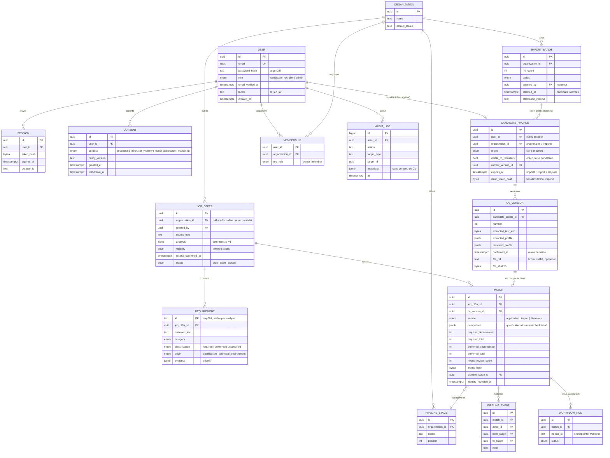

# TalentFlow AI v1.0 — document de conception

*Statut : **validé le 2026-11-27**, avec les arbitrages et décisions du §11. Base de départ : `v0.7.0`. Marché v1 : **Maroc uniquement** (loi 09-08, CNDP).*

---

## 0. Résumé

TalentFlow AI passe d'un **outil local à session unique** à une **plateforme à deux espaces**, Recruteur et Candidat, avec comptes, persistance et collaboration. Le cœur reste inchangé : extraction déterministe des CV, analyse d'offre, comparaison par preuves liées aux sources, revue humaine obligatoire et graphe LangGraph avec interruption.

La nouveauté la plus sensible est le **classement transparent par couverture documentaire**. Il remplace l'ancien principe « no ranking ». Il ne produit aucun score, il trie de façon lexicographique sur des comptes vérifiables, chaque chiffre s'ouvre sur ses preuves, l'identité est masquée par défaut et aucune décision n'est automatisée.

### Nouveau positionnement produit (remplacera « no ranking » dans le README)

> **TalentFlow AI organise les candidatures par couverture documentaire, jamais par score opaque.** Chaque position s'explique par des critères comptés (« 5/6 requis · 2/3 souhaités ») et chaque chiffre s'ouvre sur l'extrait exact du CV et de l'offre. Le classement est anonyme par défaut, ne mesure pas la compétence réelle et ne rejette ni n'accepte personne : la décision appartient toujours au recruteur. Côté candidat, la même transparence montre ce qu'un CV documente déjà, ce qui manque et ce qui reste à interpréter, sans jamais inventer de compétence.

Formulation courte pour le haut du README :

> *Évidence plutôt que score : un classement par couverture documentaire, anonyme par défaut, où chaque chiffre renvoie à sa preuve et où la décision reste humaine.*

Les garde-fous qui restent **non négociables** dans la v1 :
- pas de score, pas de pourcentage, pas de jauge ;
- pas de décision automatique (rejet, acceptation, présélection silencieuse) ;
- revue humaine des profils et des critères avant toute comparaison ;
- « non documenté » ne signifie jamais « incompétent » ;
- aucun LLM externe sans configuration explicite **et** consentement ;
- aucun CV réel dans le dépôt, aucun secret commité.

---

## 1. Vision produit et rôles

| Rôle | Objectif | Accès |
|---|---|---|
| **Visiteur** | Comprendre le produit, essayer la démo fictive | Page d'accueil, démo (sans persistance), pages légales |
| **Candidat** | Maintenir son CV, mesurer sa couverture face à des offres, combler honnêtement les écarts | Ses propres données uniquement |
| **Recruteur** | Créer des offres, importer des CV, examiner un classement transparent, gérer un pipeline | Données de son organisation uniquement |
| **Admin plateforme** | Exploitation, support, audit | Console d'administration, sans accès au contenu des CV par défaut (« break-glass » journalisé) |

Le rôle est choisi **à l'inscription** (Recruteur ou Candidat). Un même e-mail ne peut avoir qu'un rôle en v1 (décision D3, §11).

**Périmètre géographique** : la v1 s'adresse uniquement à des utilisateurs au Maroc. Aucune offre de service n'est faite à des utilisateurs situés dans l'UE. **Toute version en ligne est une démonstration** : données fictives ou utilisateurs invités, avec un avertissement visible en permanence (bandeau « Version de démonstration ») sur les pages publiques et dans les espaces connectés.

---

## 2. Architecture

### 2.1 Vue d'ensemble

```mermaid
flowchart LR
    browser["Navigateur<br/>React + design system v0.7"] -->|"HTTPS, même origine"| nginx["Nginx<br/>TLS, limites, en-têtes"]
    nginx --> api["FastAPI<br/>auth · rôles · CSRF · rate limit"]
    api --> pg[("PostgreSQL 17<br/>SQLAlchemy 2 + Alembic")]
    api --> files[("Stockage fichiers<br/>originaux chiffrés (option)")]
    api -->|"enqueue"| queue[("File de tâches<br/>table Postgres")]
    worker["Worker(s)<br/>parsing, analyse, comparaison"] -->|"SKIP LOCKED"| queue
    worker --> pg
    worker --> files
    api --> graph["LangGraph<br/>checkpointer Postgres"]
    graph --> pg
```

Services Compose : `frontend`, `backend`, `worker` et `db`. Le profil `db` devient **obligatoire** : `db` sort des profils et le backend en dépend via `depends_on: condition: service_healthy`. Le volume `postgres_data` reste inchangé.

### 2.2 Authentification : sessions par cookie httpOnly (choix retenu)

**Décision : sessions côté serveur**, avec un cookie `__Host-tf_session` (`HttpOnly`, `Secure`, `SameSite=Lax`, `Path=/`), plutôt que des JWT.

| Critère | Sessions cookie | JWT |
|---|---|---|
| Exposition au XSS | Le jeton n'est jamais lisible en JS | Stocké en JS (localStorage) ou en cookie (on revient alors aux sessions) |
| Révocation (logout, vol, changement de mot de passe) | Immédiate : on supprime la ligne de session | Impose une liste de révocation ou des durées très courtes plus un refresh |
| Architecture | SPA servie par la **même origine** via Nginx : le cas idéal du cookie | Utile pour des API tierces ou du multi-domaine, absents de la v1 |
| Complexité | Table `sessions`, rotation à la connexion | Rotation des refresh tokens, détection de réutilisation, gestion des clés |
| CSRF | À traiter (§5.1) | Évité seulement si le jeton n'est pas dans un cookie |

Détails :
- **Hash des mots de passe** : **argon2id** (`argon2-cffi`), paramètres de base OWASP (m = 19 MiB, t = 2, p = 1, à ajuster par benchmark) et re-hash transparent si les paramètres évoluent. bcrypt est écarté (limite de 72 octets, moins résistant aux GPU).
- **Session** : identifiant aléatoire de 256 bits, stocké **haché** (SHA-256) en base. Expiration glissante de 12 h, absolue de 7 jours. Rotation de l'identifiant à la connexion et à toute élévation de privilège.
- **Vérification d'e-mail** obligatoire avant tout traitement de CV ; jetons à usage unique, hachés, valables 24 h.
- **Réinitialisation du mot de passe** : jeton haché valable 30 min, invalidation de toutes les sessions ensuite.
- **MFA TOTP** : obligatoire pour les recruteurs en phase 11 (décision D11) ; pas livrée en phase 6.
- **Envoi d'e-mails** : un fournisseur SMTP est un service externe, donc une question de confidentialité (décision D8). En développement et en démo, un **Mailpit** local en Compose ; aucun fournisseur externe en v1.

### 2.3 Rôles et autorisations

- **Modèle** : `User.role ∈ {candidate, recruiter, admin}`. Les recruteurs appartiennent à une **Organization** via une `Membership` (`owner`, `member`).
- **Principe** : refus par défaut. Chaque route déclare son rôle (`Depends(require_role("recruiter"))`) **et** chaque requête de données est filtrée par propriétaire (`candidate_id = current_user` ou `organization_id ∈ memberships`). Aucun accès par identifiant seul.
- **Défense en profondeur (phase 11)** : Row-Level Security PostgreSQL sur les tables multi-locataires, avec `SET LOCAL app.org_id` par transaction.
- **Visibilité d'un profil candidat par un recruteur**, accordée uniquement si l'une de ces conditions est vraie :
  1. le candidat **a postulé** à une offre de l'organisation (Application) ;
  2. le CV a été **importé par l'organisation** (profil « importé », sans compte candidat) ;
  3. le candidat a **activé sa visibilité** (opt-in) **et** consenti à être proposé aux recruteurs.

### 2.4 Persistance : PostgreSQL, SQLAlchemy 2, Alembic

- **SQLAlchemy 2.0** avec mapping typé (`Mapped[...]`) et **psycopg 3**. Sessions **synchrones** dans le threadpool existant : le code de parsing et de comparaison est synchrone, l'async n'apporterait que de la complexité.
- **Alembic** pour les migrations : une migration par PR, réversible, testée en CI (`upgrade` → `downgrade` → `upgrade` sur une base vide).
- **Identifiants** : UUID v7 (triables), jamais d'identifiants séquentiels exposés.
- **Horodatage** : `created_at` et `updated_at` en UTC ; suppression logique **interdite** pour les données personnelles (on supprime réellement, voir §4).
- **Résultats calculés** (analyse, comparaison) : stockés en `JSONB`, avec version de méthode (`deterministic-v1`, `qualification-document-checklist-v1`) et hash des entrées, pour la reproductibilité.

### 2.5 Stockage des CV

**Décision (arbitrage A3) : texte du CV uniquement, chiffré. Le PDF original est optionnel et désactivé par défaut**, côté candidat comme côté recruteur.

| Donnée | Conservée ? | Forme |
|---|---|---|
| Texte extrait plus positions de mise en page | Oui | `CVVersion.extracted_text` (chiffré au niveau colonne, §5.5) |
| Profil structuré extrait et profil revu | Oui | `JSONB` |
| PDF original | **Non par défaut.** Option à activer explicitement (par le candidat pour ses CV, par l'organisation pour ses imports) | Fichier chiffré **AES-256-GCM** par enveloppe : une clé de données par fichier, chiffrée par une clé maître fournie par variable d'environnement. Volume Docker `cv_files`. |

La suppression d'un CV entraîne l'effacement du fichier **et** de sa clé de données (*crypto-shredding*), ce qui couvre aussi les sauvegardes.

### 2.6 File de traitement (import en masse)

**Décision proposée : file en base PostgreSQL** (table `jobs` avec `SELECT … FOR UPDATE SKIP LOCKED`) et un service `worker` dédié. Il n'y a ni Redis ni broker à exploiter : le projet reste local-first et simple. Une bibliothèque comme `procrastinate` est possible ; sinon une implémentation maison d'environ 150 lignes, testée.

- **Import** : jusqu'à **200 fichiers par lot**, 5 MiB et 10 pages par fichier (limites actuelles), **pas d'archive ZIP** en v1 (risque de bombe de décompression). Le parsing se fait dans le worker, avec des limites CPU et mémoire et **sans accès réseau**.
- **États par fichier** : `queued → parsing → parsed → needs_review → confirmed | failed`. Progression lisible via `GET /imports/{id}`.
- **Idempotence** : hash SHA-256 du fichier par organisation, pour détecter les doublons.
- Après le parsing, chaque profil **reste à revoir** : les profils importés non revus n'entrent pas dans le classement (§3.3).

### 2.7 Graphe LangGraph

Le checkpointer en mémoire est remplacé par **`langgraph-checkpoint-postgres`**. Les workflows survivent au redémarrage, sont rattachés à un `Match`, et leur `interrupt()` de revue humaine devient une **tâche visible** dans l'espace recruteur. La TTL est remplacée par la politique de rétention (§4.4).

---

## 3. Modèle de données

### 3.1 Diagramme ER



`Role` est une **énumération** sur `User` plutôt qu'une table : trois rôles fixes, ce qui évite une jointure. On passera à une table de permissions le jour où des rôles fins seront demandés (question §9).

### 3.2 Règles d'intégrité

- Un `Match` n'existe que si l'offre a des **critères confirmés** (`criteria_confirmed_at`) et si la `CVVersion` est **revue** (`confirmed_at`). C'est la transposition directe des garde-fous actuels.
- Toute modification des critères ou du profil revu **invalide** les `Match` concernés (recalcul en tâche). C'est l'équivalent persistant de l'invalidation actuelle en session.
- `required_*` et `preferred_*` excluent les critères `origin = technical_environment`, conformément à la sémantique actuelle.

### 3.3 Règles de classement (non négociables)

1. **Clé de tri lexicographique**, et rien d'autre :
   `(required_documented DESC, preferred_documented DESC, needs_review_count ASC)`.
2. **Les ex æquo sont affichés comme des groupes** (« même couverture ») dans un ordre neutre et stable : ordre d'arrivée, avec le libellé « ordre d'arrivée, non significatif ». Aucun critère caché ne départage.
3. **Affichage** : « **5/6 requis · 2/3 souhaités · 1 à interpréter** ». Chaque nombre est un bouton qui ouvre la **vue preuve côte à côte** filtrée sur les critères concernés.
4. **Mode anonyme activé par défaut** : nom, photo, contact, ville, dates, employeurs et URL sont masqués. Le libellé devient « Candidat·e A-17 » (alias stable par offre). La levée d'anonymat est **volontaire, par profil**, demande un motif (liste plus texte libre) et est **journalisée** (`AUDIT_LOG: match.identity_revealed`).
5. **Mention permanente**, non masquable, au-dessus du classement :
   > « Classement par couverture documentaire. Il n'évalue pas la compétence réelle. La décision appartient au recruteur. »
6. **Aucune action automatique** : pas de seuil de rejet, pas de « top N » auto-présélectionné, pas d'e-mail de refus déclenché par la position.
7. **Profils exclus du classement** : profils importés non revus et CV non confirmés. Ils apparaissent dans une liste séparée « À revoir ».
8. La comparaison réutilise **telle quelle** `compare_job`. Le classement n'ajoute que le tri et les comptes.

---

## 4. API (versionnée)

Les routes actuelles `/api/v1/*` restent disponibles pour le **mode démo public**, sans compte et sans persistance. Les nouvelles routes vivent sous **`/api/v2`**, qui exige une session.

Conventions :
- toute méthode non sûre (`POST`, `PUT`, `PATCH`, `DELETE`) exige l'en-tête **`X-CSRF-Token`** ;
- les réponses d'erreur gardent le format `{"detail": {"code", "message"}}` ;
- la pagination se fait par curseur.

### 4.1 Authentification et compte

| Méthode et route | Rôle | Note |
|---|---|---|
| `POST /api/v2/auth/register` | public | `{email, password, role, locale, consents[]}` ; consentement `processing` requis |
| `POST /api/v2/auth/login` · `POST /auth/logout` | public · connecté | rate limit strict, réponse identique en cas d'échec |
| `GET /api/v2/auth/me` · `GET /auth/csrf` | connecté | rôle, locale, jeton CSRF |
| `POST /api/v2/auth/verify-email` · `/password/forgot` · `/password/reset` | public | jetons à usage unique |
| `GET /api/v2/me/export` | connecté | export portable (JSON plus fichiers) |
| `DELETE /api/v2/me` | connecté | suppression complète (§5.3), ré-authentification requise |
| `GET/PUT /api/v2/me/consents` | connecté | accorder ou retirer, par finalité |

### 4.2 Espace candidat (`role = candidate`)

| Méthode et route | Note |
|---|---|
| `POST /api/v2/me/cv` | nouvelle version (multipart) ; parsing asynchrone |
| `GET /api/v2/me/cv/versions` · `GET /me/cv/versions/{id}` | historique et diff entre versions |
| `PUT /api/v2/me/cv/versions/{id}/review` · `POST …/confirm` | revue humaine (reprend `ReviewProfile`) |
| `PUT /api/v2/me/visibility` | opt-in à la visibilité recruteur, avec consentement `recruiter_visibility` |
| `POST /api/v2/me/targets` | offre collée (analysée, privée au candidat) ou référence d'offre publique |
| `PUT /api/v2/me/targets/{id}/requirements` · `POST …/confirm` | revue des critères par le candidat |
| `GET /api/v2/me/targets/{id}/coverage` | rapport de couverture plus preuves (comparaison existante) |
| `GET /api/v2/me/targets/{id}/gaps` | analyse des écarts (§6.3) |
| `GET /api/v2/me/recommendations` | offres publiques triées par la même clé lexicographique |
| `POST /api/v2/jobs/{id}/apply` | candidature : crée un `Match` côté organisation |

### 4.3 Espace recruteur (`role = recruiter`, filtré par organisation)

| Méthode et route | Note |
|---|---|
| `POST/GET /api/v2/orgs` · `/orgs/{id}/members` | création, invitations (`owner` seulement) |
| `POST/GET/PATCH /api/v2/jobs` | offres de l'organisation |
| `POST /api/v2/jobs/{id}/analyze` · `PUT …/requirements` · `POST …/confirm-criteria` | réutilise l'analyse et la revue existantes |
| `POST /api/v2/imports` · `GET /imports/{id}` | import en masse (≤ 200 fichiers), progression |
| `GET /api/v2/imports/{id}/review-queue` | profils à revoir avant classement |
| `GET /api/v2/jobs/{id}/ranking` | **anonyme par défaut** ; `?reveal=` interdit (pas de levée globale) |
| `GET /api/v2/matches/{id}` · `GET …/evidence?requirement=` | preuves côte à côte |
| `POST /api/v2/matches/{id}/reveal` | levée d'anonymat avec `{reason}`, journalisée |
| `GET /api/v2/jobs/{id}/pipeline` · `PATCH /matches/{id}/stage` | Kanban ; chaque déplacement crée un `PipelineEvent` |
| `GET /api/v2/compare?a={match}&b={match}` | comparaison de deux candidats sur les mêmes critères |
| `POST /api/v2/matches/{id}/report` → `GET /reports/{id}.pdf` | export PDF du rapport de preuves (tâche asynchrone) |
| `POST /api/v2/matches/{id}/workflow` · `/resume` · `/cancel` | graphe LangGraph persistant (interrupt/resume) |

### 4.4 Administration (`role = admin`)

| Méthode et route | Note |
|---|---|
| `GET /api/v2/admin/audit` | lecture du journal, filtrable |
| `GET /api/v2/admin/users` · `POST …/{id}/disable` | support ; **aucun accès au contenu des CV** |
| `POST /api/v2/admin/break-glass` | accès exceptionnel motivé, durée limitée et notifié à l'organisation |

### 4.5 Règles d'accès transverses

- Toute route `/api/v2` exige une session valide **et** un rôle autorisé, et filtre par propriétaire. Un recruteur de l'organisation A reçoit une **404** (et non une 403) pour toute ressource de l'organisation B, pour ne pas révéler son existence.
- Les tests d'isolation sont **générés** : pour chaque route paramétrée, les acteurs d'une autre organisation, d'un autre candidat ou anonymes doivent recevoir 401 ou 404 (§8, Phase 6).

---

## 5. Confidentialité et conformité

### 5.1 Cadres applicables

**Marché v1 : Maroc uniquement (arbitrage A1).** Le seul cadre applicable visé est la loi 09-08 ; aucune offre de service n'est faite à des utilisateurs dans l'UE.

- **Maroc — loi 09-08** (protection des personnes physiques à l'égard du traitement des données à caractère personnel) et **CNDP** :
  - déclaration préalable du traitement auprès de la CNDP, ou demande d'autorisation selon la nature des données ;
  - autorisation pour tout **transfert hors du Maroc** (hébergement, fournisseur d'e-mail) : la v1 n'en prévoit aucun ;
  - droits d'information, d'accès, de rectification et d'opposition ;
  - encadrement des décisions fondées sur un traitement automatisé.
- **Toute version en ligne est une démo** : données fictives ou utilisateurs invités, avertissement visible. Une mise en production avec des données réelles exige la déclaration CNDP et la validation juridique de la phase 11.
- **Hors périmètre v1 : RGPD et AI Act.** Les **CGU** prévues (§7.1) l'indiquent explicitement : le service est destiné aux utilisateurs situés au Maroc et n'est pas proposé dans l'Union européenne. Pour mémoire, une ouverture à l'UE déclencherait le RGPD complet (art. 13, 14, 22, AIPD, DPA avec les recruteurs) et la qualification **à haut risque** de l'AI Act (annexe III, tri de candidatures). Elle exigerait un nouvel avis juridique et une révision de ce document avant toute offre.

**Engagements dans les CGU prévues** (pages légales de la phase 6, version de démonstration) :
- service destiné aux utilisateurs situés au Maroc, non proposé dans l'Union européenne ;
- toute instance en ligne est une démonstration : ne pas y déposer de CV réel en dehors d'un accès invité accordé explicitement ;
- le classement décrit une couverture documentaire, pas une compétence, et aucune décision n'est automatisée ;
- le recruteur qui importe des CV atteste avoir informé les candidats (§5.2) ;
- durées de conservation du §5.4 ; droits d'accès, de rectification, d'opposition et de suppression.

> Ce document n'est pas un avis juridique. Une validation par un·e juriste (droit marocain et RGPD) est un **critère d'entrée de la phase 11** et un prérequis à toute mise en production avec des données réelles.

### 5.2 Consentement explicite

- Chaque finalité est **séparée** :
  - `processing` (nécessaire au service candidat) ;
  - `recruiter_visibility` (opt-in) ;
  - `model_assistance` (LLM externe, par envoi, comme aujourd'hui) ;
  - `marketing` (jamais pré-cochée).
- Chaque consentement est versionné (`policy_version`) et horodaté. Il est retirable aussi facilement qu'accordé, et son retrait a un effet immédiat : par exemple, le retrait de `recruiter_visibility` sort le profil de la découverte.
- **CV importés par un recruteur sans compte candidat (arbitrage A2)** :
  - l'import n'est possible que si le recruteur **coche une attestation** : « Les candidats ont été informés du traitement de leur CV » ;
  - l'attestation est **horodatée et journalisée** (`ImportBatch.attested_at`, `attested_by`, `attestation_version` et `AUDIT_LOG: import.attested`) ; sans elle, `POST /imports` renvoie 422 ;
  - ces CV sont **supprimés automatiquement 90 jours après l'import** (`CandidateProfile.expires_at`), même si l'offre est encore ouverte ;
  - pour chaque profil importé, le recruteur peut générer un **lien d'invitation** à usage unique (jeton haché) qui permet au candidat de **revendiquer** son profil (création d'un compte candidat qui en devient propriétaire, la suppression à 90 jours ne s'applique plus), de le **corriger** ou de le **supprimer** immédiatement.

### 5.3 Droit de suppression complète

`DELETE /api/v2/me` (candidat) ou suppression d'un profil importé (recruteur, ou opposition de la personne) entraîne :
1. la suppression des `CVVersion`, du `CandidateProfile`, des `Match` et des `WorkflowRun` (checkpoints inclus), des `Consent` (après archivage minimal de la preuve de retrait) et des sessions ;
2. le **crypto-shredding** des fichiers : la clé de données est détruite, puis le fichier ;
3. une entrée d'audit `account.deleted`, conservée sans donnée identifiante (identifiant haché) ;
4. un délai de purge des sauvegardes documenté (35 jours maximum) ; le crypto-shredding rend les copies illisibles dès l'étape 2.

### 5.4 Rétention (arbitrage A3)

| Donnée | Durée |
|---|---|
| Compte candidat inactif | Suppression après **12 mois** d'inactivité, avec un **e-mail de préavis 30 jours avant** (au 11ᵉ mois) |
| CV importé sans compte candidat | **90 jours après l'import**, sauf revendication par le candidat (§5.2) |
| Données d'une offre clôturée (offre, critères, `Match`, pipeline, workflows) | **6 mois après la clôture** |
| PDF original | Non conservé par défaut ; s'il est activé, il suit la durée de la donnée à laquelle il est rattaché |
| Journal d'audit | **12 mois** (pseudonymisé) |
| Sessions | expiration absolue de 7 jours ; purge quotidienne |
| Rapports PDF exportés | 30 jours |

Les purges sont exécutées par des **tâches planifiées** du worker, elles-mêmes journalisées.

### 5.5 Protection des données

- Chiffrement au repos : volume Postgres et sauvegardes chiffrés ; colonnes sensibles (`extracted_text_enc`, contacts) chiffrées applicativement ; fichiers chiffrés par enveloppe.
- La **projection limitée aux qualifications** reste la seule entrée de la comparaison et du classement. L'identité ne participe jamais au tri.
- Journal d'audit **en ajout seul** (table sans droits `UPDATE`/`DELETE` pour le rôle applicatif). Il contient les connexions, les levées d'anonymat, les exports, les changements d'étape, les suppressions, les accès break-glass et les changements de consentement.

---

## 6. Sécurité

| Sujet | Mesure |
|---|---|
| **CSRF** | `SameSite=Lax`, plus un jeton synchronisé (`GET /auth/csrf`, renvoyé en `X-CSRF-Token`) vérifié sur toute méthode non sûre ; vérification d'`Origin`/`Referer` (le contrôle local existant est étendu au domaine de production). |
| **Rate limiting** | `limit_req` dans Nginx (par IP), plus des limites applicatives par compte (login : 5 par min et 20 par heure avec temporisation progressive ; inscription ; upload : 20 fichiers par min par compte ; import en masse : 3 lots par heure par organisation). Réponses 429 avec `Retry-After`. |
| **Uploads** | Contrôles actuels conservés : octets magiques `%PDF-`, 5 MiB, 10 pages, PDF chiffrés et endommagés refusés, plafond de texte. Ajouts : parsing **dans le worker** isolé (sans réseau, limites CPU/mémoire, timeout), noms de fichiers jamais réutilisés comme chemins, pas de ZIP en v1. Antivirus ClamAV optionnel (§9). |
| **Isolation entre recruteurs** | Filtrage systématique par `organization_id` dans une couche de dépôt unique (aucune requête brute dans les routes), tests d'isolation générés, puis RLS Postgres en phase 11. |
| **Secrets** | Docker secrets ou variables d'environnement hors dépôt ; clé maître de chiffrement séparée de la base ; rotation documentée ; `.env.example` sans valeur réelle ; analyse des secrets en CI (`gitleaks`). |
| **En-têtes** | CSP stricte (`default-src 'self'`, sans `unsafe-inline` en JS ; le script de thème est inliné avec un hash), HSTS, `X-Content-Type-Options`, `Referrer-Policy`, `Permissions-Policy`. |
| **Dépendances** | `pip-audit` et `npm audit` en CI, Dependabot ; images Docker épinglées par digest (déjà en place). |
| **Journalisation** | Aucun contenu de CV ni de mot de passe dans les logs applicatifs ; identifiants de corrélation. |
| **Tests** | Tests de sécurité dédiés (CSRF, isolation, rate limit, upload malveillant) ; test d'intrusion externe en phase 11. |

---

## 7. UX

Le design system v0.7 est réutilisé tel quel : tokens, thèmes clair et sombre, Stepper, StatusPill, EmptyState, Skeleton, toasts, **vue preuve côte à côte**, **graphe vivant**. Aucun nouveau langage visuel n'est introduit.

### 7.1 Public

- **Accueil** : héro (positionnement du §0), démo fictive existante, principes, « Comment fonctionne le classement », liens légaux, et l'**avertissement de démonstration** (« Version de démonstration : données fictives ou utilisateurs invités uniquement. Service destiné au Maroc. ») visible sans défilement.
- **Inscription** : choix du rôle (deux cartes Recruteur et Candidat, chacune expliquant ce qu'elle permet), e-mail, mot de passe (indicateur de robustesse, sans règles arbitraires), consentements séparés et non pré-cochés, langue.
- **Connexion**, **mot de passe oublié**, **vérification d'e-mail**.
- **Pages légales** : politique de confidentialité, CGU (engagements du §5.1 : Maroc uniquement, démo), explication du classement, contact du responsable du traitement.

### 7.2 Parcours candidat

```text
Inscription → Vérification e-mail → Onboarding (consentements, visibilité OFF par défaut)
→ Déposer mon CV → Revoir et confirmer (ReviewProfile) → Mes offres (coller / choisir)
→ Revoir les critères → Rapport de couverture (vue preuve) → Écarts (« ajoutez-le si c'est vrai »)
→ Mettre à jour le CV (nouvelle version) → Recommandations → Postuler
```

Écrans :
- tableau de bord candidat (stepper adapté) ;
- mon CV (version courante, historique, **diff entre versions**) ;
- revue ;
- mes offres ;
- rapport de couverture, qui affiche le même décompte « 5/6 requis · 2/3 souhaités » que le recruteur ;
- écarts ;
- recommandations ;
- visibilité et consentements ;
- mes données (export, suppression).

**Analyse des écarts honnête** :
- pour un critère `not_documented`, le message est : « Ce critère n'apparaît pas dans votre CV. **Si c'est vrai**, ajoutez-le avec un exemple vérifiable » ;
- un lien ouvre la revue du CV sur la section concernée ;
- **aucun texte n'est généré** à la place du candidat ;
- les critères `needs_review` expliquent pourquoi une personne doit interpréter (durée, niveau, équivalence) ;
- il n'y a jamais de « vous n'êtes pas qualifié·e ».

**Recommandations** : offres publiques triées par la même clé lexicographique. Chacune affiche son décompte et le lien vers ses preuves. La mention « couverture documentaire, pas une évaluation » y figure aussi.

### 7.3 Parcours recruteur

```text
Inscription → Créer / rejoindre une organisation → Créer une offre → Analyser → Revoir et confirmer les critères
→ Importer des CV (masse) → File « À revoir » → Classement anonyme → Ouvrir les preuves
→ (option) Lever l'anonymat avec motif → Pipeline Kanban → Comparer deux candidats → Export PDF
```

Écrans :
- **Offres** : liste avec statut et nombre de candidatures.
- **Éditeur d'offre** : l'écran Job Analysis actuel, découpé, persisté.
- **Import** : dépôt multiple, progression par fichier en squelettes, erreurs explicites, doublons signalés.
- **À revoir** : revue rapide en enchaînement clavier.
- **Classement** :
  - mention permanente en tête ;
  - tableau trié avec groupes d'ex æquo ;
  - colonnes « requis », « souhaités », « à interpréter », chaque nombre ouvrant un tiroir de preuves côte à côte ;
  - alias anonymes ;
  - bouton « Voir l'identité » par ligne, avec motif ;
  - **aucune couleur rouge** pour les absences.
- **Pipeline Kanban** : colonnes d'étapes configurables. Le glisser-déposer a une **alternative clavier complète** (menu « Déplacer vers… »). Chaque déplacement est historisé. Pas d'étape « rejeté automatiquement ».
- **Comparer deux candidats** : matrice critère par critère, côte à côte, sans gagnant désigné.
- **Rapport PDF** : en-tête de l'offre, mention de classement, critères avec leurs extraits exacts et offsets, statut de revue, date et version de méthode ; anonyme sauf levée d'anonymat préalable.
- **Graphe LangGraph** : revue par `Match`, avec la page AI Agents actuelle intégrée en tiroir.
- **Organisation** : membres, étapes de pipeline, rétention, journal d'audit de l'organisation.

### 7.4 Internationalisation FR / EN / AR

- Bibliothèque **`i18next` et `react-i18next`** (messages ICU, pluriels). Le français est la langue par défaut ; l'anglais est livré en phase 6 ; l'arabe est prévu en phase 11.
- **Aucune chaîne en dur** dans les nouveaux composants. Les chaînes existantes sont migrées progressivement, en conservant les **noms accessibles anglais testés** jusqu'à la migration des tests (les E2E ciblent la locale `en`).
- **RTL** :
  - tous les nouveaux styles utilisent les **propriétés logiques CSS** (`margin-inline`, `padding-inline-start`, `inset-inline`) ;
  - les styles existants sont migrés par un script, comme pour les tokens ;
  - `dir="rtl"` et `lang="ar"` sur `<html>` ;
  - les icônes directionnelles sont mirrorées ;
  - les offsets restent en points de code (indépendants du sens).
- **Polices** : IBM Plex Sans Arabic et Noto Naskh Arabic via `@fontsource`, ajoutées au token `--font-sans` sous `:lang(ar)`.
- **Formats** : dates et nombres via `Intl`, chiffres arabes occidentaux par défaut.
- **Hors périmètre v1** : le parsing des CV et des offres en arabe (décision D12). L'analyse reste en FR/EN, et c'est affiché clairement.

---

## 8. Ce qui est conservé

| Composant actuel | Devenir en v1 |
|---|---|
| Parsing PDF déterministe (PyMuPDF, mise en page, FR/EN, preuves) | Inchangé ; exécuté dans le worker ; résultats persistés dans `CVVersion` |
| LLM optionnel avec consentement par envoi | Inchangé ; le consentement devient aussi une ligne `Consent` |
| Analyse d'offre déterministe et revue des critères | Inchangées ; persistées dans `JobOffer` et `Requirement` |
| `compare_job` (projection limitée aux qualifications, 3 statuts, offsets) | **Moteur unique** du rapport de couverture, du classement et de la comparaison à deux |
| Garde-fous de revue (profil et critères confirmés, invalidation) | Transposés en contraintes de base et en invalidation des `Match` |
| Graphe LangGraph à 7 nœuds avec interrupt/resume | Conservé ; checkpointer Postgres ; une revue par `Match` |
| Contrôles de limites, de Host/Origin et de taille | Conservés et étendus (§6) |
| Design system, vue preuve côte à côte, graphe vivant, démo fictive | Réutilisés dans les deux espaces ; la démo reste publique sans persistance |
| 681 tests backend, 93 frontend, 10 E2E, CI | Conservés ; les nouveaux tests s'ajoutent par phase |

---

## 9. Découpage en phases

Chaque phase est livrable et testable seule. Elle se termine par un tag, une CI verte et une mise à jour du CHANGELOG.

### Phase 6 — Fondations : base, comptes, rôles (v0.8.0)

- **Périmètre** :
  - Postgres obligatoire, SQLAlchemy 2, Alembic (migrations réversibles), service `worker` vide ;
  - `User`, `Session`, `Consent`, `AuditLog`, `EmailToken`, plus `Organization` et `Membership` minimales (création par un recruteur, lecture par ses membres) pour tester l'isolation ;
  - inscription avec choix du rôle, connexion, déconnexion, vérification d'e-mail (Mailpit local), réinitialisation du mot de passe, **suppression du compte** ;
  - argon2id, CSRF, rate limiting et en-têtes de sécurité ;
  - i18n FR/EN (structure et nouvelles pages) ;
  - pages publiques (accueil avec avertissement de démo, inscription, choix du rôle, connexion, CGU et confidentialité) ;
  - démo `/api/v1` conservée publique, sans compte ;
  - secrets uniquement par variables d'environnement (`.env.example` à jour).
- **Critères d'acceptation** :
  - `docker compose up` lance `db`, `backend`, `worker` et `frontend` (plus `mailpit` en local) ;
  - les migrations `upgrade`/`downgrade` sont propres, testées en CI sur un service Postgres ;
  - un utilisateur s'inscrit avec un rôle, vérifie son e-mail, se connecte et se déconnecte ;
  - la session est révoquée au logout ;
  - toute route `/api/v2` sans session renvoie 401 ;
  - un POST sans jeton CSRF renvoie 403 ;
  - les essais de connexion sont limités ;
  - les consentements sont versionnés et retirables ;
  - la suppression du compte efface l'utilisateur, ses sessions, consentements et adhésions, et laisse une trace d'audit pseudonymisée.
- **Tests** :
  - unitaires : hash et re-hash argon2, jetons, middleware CSRF, rate limiter, modèles et migrations ;
  - API : parcours d'authentification, cas négatifs (énumération d'e-mail, jeton expiré, session volée), **matrice d'autorisation générée** (rôles et organisations) ;
  - E2E : `auth-smoke` (inscription, choix du rôle, vérification, connexion, déconnexion, suppression du compte, FR et EN), les 10 E2E existants dont `demo-smoke` toujours verts sans compte.

### Phase 7 — Espace candidat (v0.9.0)

*Livrée sur `feat/v1-phase7` ; écarts assumés (parsing synchrone, opt-in par le consentement existant, critères en JSONB) : [candidate_space_phase7.md](candidate_space_phase7.md).*

- **Périmètre** :
  - dépôt de CV avec versions (texte chiffré, PDF optionnel), revue, historique et diff ;
  - offres collées, revue des critères, rapport de couverture (vue côte à côte) et analyse des écarts ;
  - visibilité opt-in ;
  - export et suppression complète.
- **Critères d'acceptation** :
  - une nouvelle version n'écrase jamais l'ancienne ;
  - la couverture n'est calculée qu'après les deux revues ;
  - le décompte « x/y requis · a/b souhaités » est exact ;
  - les écarts ne génèrent aucun contenu ;
  - la suppression efface base, fichiers et clés (vérifié), l'export est complet ;
  - aucun recruteur n'accède au profil sans opt-in ni candidature.
- **Tests** :
  - unitaires : versionnage, chiffrement et crypto-shredding, calcul des comptes depuis `compare_job` ;
  - API : isolation entre candidats, consentements, suppression en cascade ;
  - E2E : `candidate-smoke` (CV, revue, offre, couverture, écart, nouvelle version, export, suppression).

### Phase 8 — Espace recruteur : offres, import, classement (v0.10.0)

- **Périmètre** :
  - organisations et membres ;
  - offres persistées avec confirmation des critères ;
  - import en masse dans la file Postgres ;
  - file « À revoir » ;
  - `Match` calculés et invalidés ;
  - **classement anonyme** selon les règles du §3.3 ;
  - tiroir de preuves ;
  - levée d'anonymat journalisée ;
  - candidatures depuis l'espace candidat.
- **Critères d'acceptation** :
  - le tri respecte exactement la clé lexicographique (propriété vérifiée sur données générées) ;
  - les ex æquo sont groupés ;
  - l'anonymat est actif par défaut et rien d'identifiant n'apparaît dans le DOM ni dans la réponse API avant la levée ;
  - la mention de classement est toujours visible ;
  - les profils non revus sont exclus ;
  - un lot de 200 PDF est traité sans bloquer l'API ;
  - **aucune action automatique** n'est liée au rang.
- **Tests** :
  - unitaires : tri lexicographique (tests de propriétés avec Hypothesis), regroupement des ex æquo, invalidation ;
  - API : isolation entre organisations (générée), projection anonyme (aucun champ d'identité dans le JSON), audit de levée ;
  - E2E : `recruiter-smoke` (offre, critères, import de 10 PDF fictifs générés, revue, classement anonyme, preuves, levée d'anonymat avec motif).

### Phase 9 — Pipeline, comparaison, rapports (v0.11.0)

- **Périmètre** :
  - Kanban avec alternative clavier ;
  - étapes configurables et historique ;
  - comparaison de deux candidats ;
  - export PDF du rapport de preuves (tâche asynchrone) ;
  - graphe LangGraph persistant par `Match`.
- **Critères d'acceptation** :
  - chaque déplacement est historisé ;
  - le Kanban est entièrement utilisable au clavier ;
  - la comparaison ne désigne pas de gagnant ;
  - le PDF reproduit les extraits et offsets exacts et reste anonyme par défaut ;
  - l'interrupt et la reprise du graphe survivent à un redémarrage.
- **Tests** :
  - unitaires : rendu PDF (contenu textuel vérifié), transitions de pipeline ;
  - API : export, ses droits et sa rétention ;
  - E2E : `pipeline-smoke` (glisser-déposer et clavier, comparaison, export PDF téléchargé et inspecté).

### Phase 10 — Découverte et recommandations (v0.12.0)

- **Périmètre** :
  - offres publiques ;
  - recommandations côté candidat avec la même clé de tri ;
  - découverte côté recruteur des profils opt-in, anonymes ;
  - notifications in-app.
- **Critères d'acceptation** :
  - seuls les profils opt-in avec consentement valide sont découvrables ;
  - le retrait de l'opt-in est immédiat ;
  - les recommandations sont explicables critère par critère.
- **Tests** : propriétés du tri, retrait de consentement, E2E `discovery-smoke`.

### Phase 11 — Conformité, durcissement, arabe (v1.0.0)

- **Périmètre** :
  - AIPD/DPIA, dossier CNDP et registre ;
  - rétention automatisée ;
  - RLS Postgres ;
  - MFA obligatoire pour les recruteurs ;
  - CSP stricte, `pip-audit` et `gitleaks` en CI ;
  - sauvegardes chiffrées et test de restauration ;
  - test d'intrusion externe ;
  - arabe et RTL (interface).
- **Critères d'acceptation** :
  - validation juridique obtenue ;
  - purges vérifiées ;
  - RLS active (test : une requête sans `app.org_id` ne voit rien) ;
  - restauration testée ;
  - interface arabe RTL sans débordement ;
  - aucun constat critique ou élevé ouvert du test d'intrusion.
- **Tests** : rétention (horloge simulée), RLS, E2E en locale `ar` (RTL), tests d'accessibilité automatisés (axe) sur tous les écrans.

---

## 10. Risques et questions initiales

### Risques

| Risque | Gravité | Atténuation proposée |
|---|---|---|
| **Le classement reste un classement** : même transparent, il influence les décisions et peut reproduire des biais d'écriture de CV (langue, style, longueur). | Élevée | Anonymat par défaut, mention permanente, preuves systématiques, pas d'action automatique, audit des levées d'anonymat, revue périodique des distributions par étape (agrégées, sans attribut protégé). |
| **Qualification « IA à haut risque » (AI Act)** si le service était proposé dans l'UE | Écartée en v1 | Marché Maroc uniquement (A1), mentionné dans les CGU ; nouvel avis juridique et révision de ce document avant toute ouverture UE. |
| **CV importés sans compte** : obligation d'information (loi 09-08), base légale fragile | Élevée | Attestation horodatée et journalisée du recruteur, suppression automatique à 90 jours, lien d'invitation pour revendiquer, corriger ou supprimer (A2). |
| **Utilisation d'une démo en ligne avec des données réelles** | Moyenne | Avertissement permanent, CGU, comptes invités, aucun fournisseur d'e-mail externe (D8, D14). |
| **Fuite entre organisations** | Élevée | Couche de dépôt unique, tests d'isolation générés, RLS. |
| **Données de CV au repos** (vol de base ou de sauvegarde) | Élevée | Chiffrement des colonnes et fichiers, clé séparée, crypto-shredding. |
| **Charge d'exploitation** (e-mail, sauvegardes, worker) pour un projet local-first | Moyenne | File Postgres (pas de broker), Mailpit en dev, runbooks. |
| **Régressions des garde-fous existants** lors de la persistance | Moyenne | Les tests actuels restent la référence ; les tests d'invalidation sont transposés. |
| **Qualité de l'extraction** sur des CV réels variés, prise pour une vérité | Moyenne | Revue obligatoire, « partial extraction » visible, file « À revoir ». |

### Questions ouvertes (toutes tranchées au §11)

1. **Hébergement cible** : local ou auto-hébergé uniquement, ou service en ligne ? (Cela conditionne CNDP, transferts, e-mail, TLS.)
2. **Marché** : Maroc seulement au départ, ou aussi l'UE ? (AI Act et RGPD complet.)
3. **Un même e-mail peut-il être candidat et recruteur ?** (Proposé : non en v1.)
4. **Conserver les PDF originaux** par défaut côté recruteur ? (Proposé : oui, 90 jours, chiffrés.)
5. **Départage des ex æquo** : ordre d'arrivée (proposé), ordre aléatoire stable, ou alphabétique de l'alias ?
6. **Affichage des critères `needs_review`** dans la clé de tri : « le moins » comme demandé (proposé), ou neutre ?
7. **Motifs de levée d'anonymat** : liste fermée (entretien planifié, vérification des références…) plus texte libre, ou texte libre seul ?
8. **Fournisseur d'e-mail** en production (service externe = transfert de données) ?
9. **Bibliothèque PDF** : WeasyPrint (HTML et CSS, réutilise les tokens, dépendances système) ou ReportLab (pur Python, mise en page manuelle) ? (Proposé : WeasyPrint dans le worker.)
10. **Antivirus** des uploads (ClamAV) dès la phase 8, ou plus tard ?
11. **MFA** obligatoire pour les recruteurs dès la phase 6, ou en phase 11 ?
12. **Arabe** : interface seule (proposé pour la v1), ou aussi le parsing de CV et d'offres en arabe (chantier d'extraction à part entière) ?
13. **Rétention** : les durées du §5.4 conviennent-elles ?
14. **Démo publique** : la conserver sur la page d'accueil en production ? (Proposé : oui, sans persistance et avec rate limit.)

---

## 11. Décisions prises (2026-11-27)

### Arbitrages de la porteuse du projet

| # | Sujet | Décision | Sections |
|---|---|---|---|
| **A1** | Marché et hébergement (Q1, Q2) | **Maroc uniquement** (loi 09-08, CNDP). Aucune offre de service à des utilisateurs dans l'UE en v1. Toute version en ligne est une **démo** (données fictives ou utilisateurs invités) avec un avertissement visible. Inscrit dans ce document et dans les CGU prévues. | §1, §5.1, §7.1 |
| **A2** | CV importés par un recruteur sans compte candidat | Autorisés **uniquement** avec l'attestation cochée « les candidats ont été informés du traitement de leur CV », horodatée et journalisée. **Suppression automatique 90 jours après l'import.** Lien d'invitation par profil pour revendiquer, corriger ou supprimer. | §3.1, §5.2, §5.4 |
| **A3** | Stockage et rétention (Q4, Q13) | Texte du CV uniquement, chiffré ; **PDF original optionnel, désactivé par défaut**. Compte candidat inactif supprimé après **12 mois**, préavis par e-mail **30 jours** avant. Données d'une offre clôturée supprimées **6 mois** après la clôture. Journal d'audit conservé **12 mois**. | §2.5, §5.4 |

### Recommandations par défaut appliquées

| # | Question | Décision |
|---|---|---|
| **D3** | Un même e-mail candidat et recruteur ? | **Non** en v1 : un compte, un rôle. Un double rôle passera par deux comptes. |
| **D5** | Départage des ex æquo | **Ordre d'arrivée**, affiché comme « ordre d'arrivée, non significatif ». |
| **D6** | `needs_review` dans la clé de tri | **Troisième clé, croissante** (« le moins d'éléments à interpréter »), comme dans la règle du §3.3. |
| **D7** | Motifs de levée d'anonymat | **Liste fermée plus texte libre** obligatoire (entretien planifié, vérification des références, demande du candidat, autre). |
| **D8** | Fournisseur d'e-mail en production | **Aucun en v1** : Mailpit local en développement et en démo. Un fournisseur réel ne sera choisi qu'avec un hébergement au Maroc ou une autorisation CNDP de transfert. |
| **D9** | Bibliothèque PDF des rapports | **WeasyPrint** dans le worker (HTML et CSS, réutilise les tokens). |
| **D10** | Antivirus des uploads | **Plus tard** : ClamAV optionnel en phase 11 ; jusque-là, contrôles actuels et parsing isolé dans le worker. |
| **D11** | MFA des recruteurs | **Obligatoire en phase 11** (TOTP) ; non livrée en phase 6. |
| **D12** | Arabe | **Interface seule** (phase 11, RTL) ; pas de parsing de CV ni d'offres en arabe en v1. |
| **D14** | Démo publique | **Conservée** sur l'accueil, sans compte ni persistance, avec rate limit et l'avertissement de démo. |
| **D15** | Cookie de session en local | `Secure` par défaut ; désactivable **uniquement** par variable d'environnement pour le développement en HTTP local (Compose), jamais en ligne. |
| **D16** | Rate limiting en phase 6 | Limiteur applicatif **en mémoire** (un seul worker uvicorn, comme LangGraph) par e-mail et par client ; `limit_req` Nginx et stockage partagé à l'ouverture multi-worker. |
| **D17** | Accueil public | Servi sur `/welcome` : `/` reste l'espace de démo local actuel (Dashboard), dont dépendent les 10 E2E existants. |
