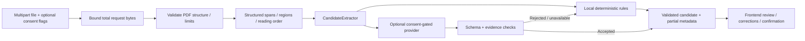

# CV parsing architecture

Phases 3.5 and 3.6 preserve the original API and PDF safety boundaries while adding layout-aware French/English rules, entry-local field evidence, an optional consent-gated provider strategy and temporary human review. See [multilingual CV parsing](multilingual_cv_parsing.md) and [accuracy/profile refinement](cv_accuracy_refinement.md) for algorithms, measured before/after evaluation and provider limits.

## Responsibilities

| Module | Responsibility |
| --- | --- |
| `app/api/upload_limits.py` | Existing bounded request buffering, including chunked requests |
| `app/api/routes/candidates.py` | File closure, consent gate, extractor seam, public configuration and domain errors |
| `app/services/pdf.py` | Structural/encryption/corruption/page/text checks and synchronized native PDF access |
| `app/services/layout.py` | Blocks/lines/spans, fonts/coordinates, header/column regions and reading order |
| `app/services/sections.py` | Exact multilingual heading aliases with normalized case/accents/punctuation |
| `app/services/extraction.py` | Existing labeled rules, expanded vocabulary and multilingual integration |
| `app/services/multilingual.py` | Header identity, natural entries, date normalization and field-source attribution |
| `app/services/records.py` | Entry anchors, complete titles, employer/location separation, wrapped/colon projects and entry-bound source references |
| `app/services/llm.py` | Provider protocol, optional compatible adapter, strict outputs, evidence rejection and fallback |
| `app/models/candidate.py` | Existing candidate shape, validated fields and additive evidence/provider metadata |

## Contracts and privacy

`POST /api/v1/candidates/parse` still accepts multipart `file` and returns `CVParsingResponse`. Unknown candidate values remain null/empty, collections have independent defaults, extra fields are rejected, dates validate calendar precision, phones validate syntax/digit count and profile URLs enforce expected hosts. Metadata reports `partial` for both strategies; no confidence percentages are generated.

Normal requests make no external call. Optional `use_llm=true` requires `external_consent=true`; absent consent is rejected. A model call additionally requires valid backend runtime configuration. `GET /api/v1/candidates/extraction-config` exposes public availability/destination/model with connectivity explicitly unchecked, never credentials. Model HTTP/errors/invalid output retain local results with a fallback warning. Source occurrence cannot verify semantic correctness, so review is mandatory.

Candidate JSON remains flat at the root. Additive evidence includes dotted field path, quote, source ID, page, optional bounding box, method and uncertainty. It returns relevant source quotations rather than the entire extracted document. No candidate text is logged or persisted; frontend originals/corrections/confirmation remain in React memory. Only explicitly consented optional requests transmit extracted text to the configured provider. The original PDF is not uploaded to a model service.

## Preserved ingestion policy

- Inclusive 5 MiB upload limit and inclusive 10-page maximum.
- Total multipart limit of file bytes plus 64 KiB overhead, based on actual received bytes.
- Inclusive 200,000 extracted-character limit after each page.
- Valid PDF header/structure required; filename/MIME are not trusted server-side evidence.
- Zero-page, encrypted (including empty-password encryption), damaged/repaired/incomplete PDFs are rejected.
- Textless PDFs are rejected because OCR is not implemented. Mixed blank/text pages produce a warning.
- Unicode accents, line/page/region boundaries and source geometry are retained.

The ASGI middleware buffers a bounded request before multipart parsing, and the upload read is capped independently. Native extraction runs off the async event loop and under a process-local PyMuPDF lock. Documents/uploads and temporary framework-managed spool resources are closed after processing. MuPDF diagnostics are disabled to avoid candidate content in logs. No permanent upload directory is introduced.

Decompression/native extraction occur before the text cap can be applied. These limits do not enforce a hard CPU deadline or native-memory ceiling. Public deployment still needs worker isolation, authentication and rate limiting. Existing CORS is a browser policy, not authorization; database health is independent of API liveness.

## Rules and tests

Phase 3.6 recognizes abbreviated French/English months, preparatory-cycle education, full role/degree subtitles and consecutive title/description projects. Geometry only orders co-baseline fragments within regions and supports clearly wrapped title spans. Employer/location/dates are separated from responsibility bullets; dates inside project titles or responsibilities remain content. Unknown dates and ambiguous metadata are omitted with warnings. PDF ligatures normalize without losing accents. Evidence is bound to each record, preventing repeated dates/institutions from referencing another entry. Optional `experience.location` and the `web_technology` skill category are additive schema extensions; the provider schema is generated from these same models. The frontend summarizes expandable grouped warnings and gives profile sections natural heights, retaining review and in-memory corrections.

Contact fields stay confined to header/contact regions, with ambiguity warnings. Section aliases support French and English and never use sentence substring matching. Labeled records remain supported; conservative role/degree/project anchors and local dates/order supplement them. Global skills come only from skills sections; experience/project technologies come from their own entries and establish no proficiency. Proficiency wording is retained in recognized language records. Unsupported dates/records remain incomplete rather than receiving inferred facts.

The unchanged 60 original backend tests are retained. New tests cover fictional multilingual PDFs/API contracts, columns and right-aligned dates, field evidence, missing/ambiguous identity, aliases, French date expressions, mixed labels, source isolation, optional consent, credentials privacy, schema/evidence rejection and provider failures. The separate evaluation script compares eight in-memory fictional PDFs with authored ground truth. Frontend/browser tests validate correction, removal, confirmation and session clearing. No live external model was used in validation; any configured model/provider still needs separate fictional-data verification.
