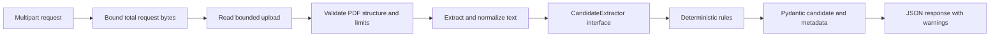

# CV parsing architecture

Phase 2 extends the Phase 1 backend without a database, frontend, LLM, OCR, or permanent CV storage.

## Pipeline

## Responsibilities

| Module | Responsibility |
| --- | --- |
| `app/api/upload_limits.py` | Bound request bytes before multipart parsing, including chunked requests without Content-Length |
| `app/api/routes/candidates.py` | Accept `file`, resolve extractor dependency, close upload, translate domain exceptions |
| `app/services/pdf.py` | Check document structure, encryption, repair state, page count and text limits; normalize text |
| `app/services/extraction.py` | Detect sections, map supported labels, match controlled dictionaries, report omissions |
| `app/models/candidate.py` | Validate contact, education, experience, skills, projects, languages, certifications, and response metadata |

The endpoint uses `response_model=CVParsingResponse`. `CandidateProfile` inherits the contact fields so the public JSON remains flat, matching the API example. All collection defaults are independently allocated. Additional fields are rejected. Email uses a conservative syntax check, not mailbox verification; phone validation checks syntax and digit count, not reachability. Contact profile URLs enforce their expected GitHub or LinkedIn host. Date labels validate calendar values while preserving precision. Date chronology and claim truthfulness are not inferred or verified.

## PDF policy and resource handling

- File limit: 5 MiB (5 × 1024 × 1024 bytes), inclusive.
- Total multipart request limit: file limit plus 64 KiB overhead, inclusive. Actual received bytes are counted.
- Page limit: 10, inclusive. Zero-page PDFs are rejected.
- Extracted text limit: 200,000 characters, checked after extracting each page.
- PDF header plus PyMuPDF document structure checks; client filenames and MIME declarations are not evidence of file type.
- Encrypted PDFs, including encryption with an empty user password, are rejected; no password authentication is attempted.
- Damaged/repaired documents and incomplete EOF markers are rejected conservatively.
- No-text documents, including image-only CVs, are rejected. Mixed text/blank documents return a warning.
- Text normalization preserves lines, blank sections, Unicode accents, and explicit page boundaries. No OCR or destructive paragraph flattening.

The ASGI middleware buffers a bounded request before multipart parsing. The upload read is independently capped at the file limit plus one byte. Processing is performed off the async event loop. A process-local lock serializes PyMuPDF access because the library does not support concurrent use in threads. Every document and upload is closed; framework-managed temporary multipart spool files may exist during the request. No permanent upload directory, candidate text logging, or raw-text response is introduced. MuPDF diagnostic printing is disabled during service processing to avoid leaking document content.

Byte, page, and extracted-text limits reduce resource exposure, but decompression and extraction occur before the text cap can be applied. They do not guarantee a CPU deadline or strict native-memory ceiling. Before a public deployment, isolate document processing in bounded workers with enforceable deadlines and resource limits; add authentication and rate limiting. CORS remains restricted to the local frontend origin and is not authorization.

## Extraction rules and uncertainty

The `CandidateExtractor` protocol takes `PDFText` and returns `CVParsingResponse`. `get_extractor` supplies the deterministic implementation through a FastAPI dependency, allowing test or future implementations to replace it without changing PDF ingestion or the response contract.

Section aliases support education/academic background, professional/work experience, technical skills, projects/personal projects, certifications/certificates, and languages/spoken languages. Contact information is taken only from the header/contact section to avoid attributing project owners or references to the candidate. Names and phones require labels; email and profile URLs may also be recognized as unique header matches. Ambiguous contact matches emit warnings.

Structured records use explicit labels. Blank lines or repeated identifying labels separate records. Unsupported prose is omitted with section warnings. Invalid optional fields are removed individually; records missing required fields are omitted. Technologies are normalized using token-boundary-aware aliases and a small dictionary. Global technical skills come only from the skills section. Mentioned technologies establish neither proficiency nor seniority. Languages use a small controlled vocabulary; certifications require a labeled title.

All unknown values stay null or empty arrays. Every response reports `status: partial` and `engine: deterministic-v1`, even if many fields were found: the rules cannot certify complete semantic extraction. Warnings report missing fields, unsupported layouts, invalid field syntax, and dictionary limitations without reproducing candidate values. No confidence percentages are fabricated.

## Error contract

Known document errors return `detail.code` and `detail.message`: 413 for byte limits, 415 for non-PDF content, 422 for invalid/empty/encrypted/corrupted/textless documents and excessive page count. FastAPI retains its native validation response for malformed request fields. Unexpected programming errors are not disguised as successful parsing or arbitrary client mistakes.

## Tests and future work

`backend/tests/fixtures/cvs.json` contains six entirely fictional scenarios: junior Python developer, data analyst, machine learning engineer, backend engineer, incomplete CV, and alternate section layout. Tests generate PDF bytes with PyMuPDF, including encrypted, blank, over-page-limit and truncated documents. Service, schema, streamed-request-limit and API tests run offline after dependency installation; Phase 1 tests remain intact.

Future work should establish job requirement contracts and extraction evaluation metrics before adding an optional LLM extractor. Require evidence/provenance for generated fields and keep the same validation and warnings contract. LangGraph can later coordinate extraction, job matching, and review. OCR, PostgreSQL, React, authentication and deployment controls are intentionally outside this implementation.

PyMuPDF API behavior was checked against its [official Document reference](https://pymupdf.readthedocs.io/en/latest/document.html).
