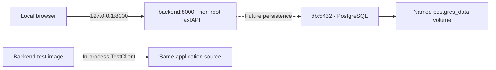

# Docker architecture

Phase 2.5 packages the existing API and test suite and provisions a local PostgreSQL instance. It adds no application tables, ORM, agents, or frontend code.

## Images and targets

`backend/Dockerfile` uses an official Python 3.11 slim Bookworm image. The base stage installs the pinned dependencies from `requirements.txt`, checks dependency consistency, and copies only application code. The `runtime` target runs Uvicorn on `0.0.0.0:8000` without reload. The `test` target adds the unchanged tests and synthetic fixture JSON and runs pytest without its cache provider. Both targets run as UID/GID 10001, use `/app`, and share the same dependency installation. No compiler or extra operating-system packages are installed.

Dependencies live in the image's `/usr/local` Python installation; they do not come from `backend/.venv`. Test tools remain installed because they are in the existing shared requirements file, but test source is absent from the runtime target. `PYTHONDONTWRITEBYTECODE` and unbuffered output prevent bytecode files and expose logs promptly.

The Compose build context is `backend`, governed by `backend/.dockerignore`. It excludes local environments, caches, secrets, logs, PDF uploads and local data while retaining application code, dependency files, tests and fictional fixture JSON. The root `.dockerignore` protects future builds that might use a root context. Neither ignore file overrides Git ignore rules.

## Reproducible dependencies

The Python base and PostgreSQL service are pinned to verified official-image digests, with readable version tags retained. `requirements.lock` records the complete Linux-resolved package set; the build installs `requirements.txt` under those constraints and runs `pip check`. No package artifacts or Windows environments are copied into the image. The build also checks that the FastAPI app imports successfully as the non-root application user.

For a deliberate dependency update, the `LOCK_FILE=/dev/null` build argument disables old constraints for a temporary resolution build. Freeze that image's package versions into the lock, review the diff, then rebuild with the default constraints and rerun tests before recreating the running service. README contains the PowerShell commands. This opt-out is not the ordinary workflow. Image digest updates require deliberate review for security maintenance. Package versions are locked, but wheel hashes are not verified and builds are not claimed to be byte-for-byte identical.

## Services

The base `docker-compose.yml` contains exactly two services:

- `backend`: publishes only `127.0.0.1:8000:8000`, runs without privileged mode or Linux capabilities, enables `no-new-privileges`, and uses an init process. A standard-library HTTP healthcheck verifies the health endpoint status and body. Its logs rotate at 10 MiB with three retained files.
- `db`: uses an official PostgreSQL 17 Bookworm image, receives database name/user/password through Compose interpolation, and persists data in the project-scoped `postgres_data` named volume mounted at `/var/lib/postgresql/data`. It has no published host port. Its healthcheck uses `pg_isready` with container environment variables, escaped with `$$` to defer interpolation to the container shell.

The services share the project-scoped default Compose network. PostgreSQL can be addressed as `db:5432` inside that network. The backend currently has no database connection settings and no `depends_on`: existing PDF and health endpoints work independently of database readiness. `unless-stopped` restarts long-running local services after unexpected exits while respecting a manual stop.

## Environment and persistence

Copy the safe `.env.example` to `.env` for local development. `.env` is ignored by Git, excluded from build contexts, and not copied or mounted into an image. Only the database service receives the three database variables. Missing or empty variables fail Compose validation rather than silently falling back to embedded credentials.

The example password is a public development placeholder, not a production secret. Replace it before shared use. Runtime environment variables are visible to users with Docker daemon access; do not print rendered Compose environment output or container inspection environments into public logs.

PostgreSQL initializes its database and user only when the data directory is empty. Editing `.env` does not rotate credentials or rename an existing database. A normal stop or `docker compose down` preserves the named volume. Database resets require explicit approval and a backup if the data matters; no destructive reset is performed by setup or validation.

## Development and tests

`compose.dev.yaml` is explicitly combined with the base file. It overrides the backend command with reload and binds only `backend/app` to `/app/app` read-only. Container dependencies in `/usr/local` are unaffected; the host Windows virtual environment is never mounted. Missing bind sources fail instead of creating empty directories. Use this override for source edits and rebuild for dependency changes.

`compose.test.yaml` overrides the backend with the dedicated test target, its own image tag, pytest command, and no restart or healthcheck. Use a one-off `docker compose run --rm --no-deps backend` with that override. One-off runs do not publish service ports unless explicitly requested and do not start PostgreSQL. Tests need no host Python, paid API, internet access, or running API after the image has been built. Source and fixtures are copied into the test image; rebuild it after code or test changes.

## Future integration

Future LangGraph orchestration can execute within the backend or a separately justified worker service, with dependency and resource changes made explicitly. PostgreSQL persistence will require application configuration, a driver, migrations and readiness/retry handling when it becomes an actual dependency. None is added here.

A future React service can use host port 5173 for local development and reach the API from the browser at `http://127.0.0.1:8000`. Existing CORS allows `http://localhost:5173`, so open the frontend with that origin. Internal service DNS such as `backend` is for containers, not the host browser. A production frontend and reverse proxy remain future design work.

## Operational limits

This is a local development foundation, not a public deployment configuration. It has no TLS, authentication, database integration, OCR, worker isolation, or enforced PDF processing deadlines. The health endpoint reports API liveness only and deliberately does not check PostgreSQL. PostgreSQL's readiness probe does not validate future application tables. Logs are available through Compose; application responses retain their existing candidate-privacy behavior.

## Phase 2.5 validation

Validated with Docker Desktop's Linux engine, Docker 29.2.1 and Compose v5.0.2. Both runtime and test image builds succeeded; dependency checks and non-root application import checks passed. The complete unchanged suite ran inside the test image on Python 3.11.17: **60 passed, 1 warning in 2.48 seconds**. The warning is the pre-existing Starlette TestClient/httpx deprecation.

Backend and PostgreSQL container healthchecks both reported healthy. Host-loopback health and Swagger requests returned HTTP 200. An in-memory synthetic PDF submitted over live HTTP returned 200 with the expected candidate name, normalized skills, partial metadata and restricted-origin CORS header. PostgreSQL accepted connections and had zero public-schema application tables.

The development override mounted only application source read-only; a timestamp-only source change triggered Uvicorn reload successfully, and the original timestamp was restored. The final running configuration was returned to the normal image command without reload or bind mounts. No database volume reset, global cleanup, host virtual-environment changes, commit, or push was performed.

References: [official Python image](https://hub.docker.com/_/python), [official PostgreSQL image and initialization policy](https://hub.docker.com/_/postgres), and [Compose override merging](https://docs.docker.com/compose/how-tos/multiple-compose-files/merge/).
