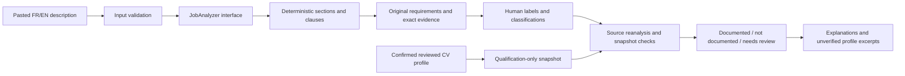

# Job analysis and qualification evidence — Phases 4 and 4.1

Phase 4 adds a local French/English job analyzer and a requirement-by-requirement document checklist. It compares explicit job-related qualifications with a reviewed profile. It produces no candidate score, ranking, eligibility decision, hiring/rejection recommendation or employment decision. AI Agents remains Coming Soon; no LangGraph, authentication, database integration or external job model is added.

Phase 4.1 adds realistic copied-post formatting, technical-environment provenance, conservative job-only vocabulary and source-bound location/contract/work-mode parsing. Environment lists are contextual technology mentions with unspecified status, separate from candidate qualifications; they remain `needs_review` during comparison even if a human changes their classification label. See [realistic job accuracy](job_analysis_accuracy.md) for the reproduced failure, independently authored corpus, reproducible baseline and executed validation. The Phase 4 measurements below remain historical results on the original ten structured fixtures.

The later [comparison workflow fix](job_comparison_workflow_fix.md) aligns unchanged requirement validation with fresh source proof, preflights qualification list bounds and exposes exact comparison blockers. Confirmation/selection works without refreshing. Current validation is 400 backend tests, 51 frontend tests and five live Chromium workflows; earlier dataset results remain their historical development measurements.



## Modules and contracts

| File | Responsibility |
| --- | --- |
| `backend/app/models/job.py` | Pydantic v2 job, requirement, source evidence, reviewed labels, qualification snapshot and comparison schemas |
| `backend/app/services/jobs.py` | `JobAnalyzer` protocol, deterministic implementation, source/review validation and evidence comparison |
| `backend/app/services/job_formatting.py` | Source-preserving decorated headings, inline metadata boundaries and explicit work-mode rules |
| `backend/app/services/job_vocabulary.py` | Job-only aliases, context/token guards and longest non-overlapping technology phrases |
| `backend/app/api/routes/jobs.py` | Versioned endpoints, injectable analyzer and structured workflow errors |
| `backend/app/main.py` | Registers the job router alongside the existing candidate and health routes |
| `frontend/src/jobTypes.ts` | Mirrored TypeScript contracts and explicit qualification projection |
| `frontend/src/jobApi.ts` | Real JSON requests through the existing timeout/error/proxy client |
| `frontend/src/jobSession.tsx` | React memory shared across routes; invalidates stale results and clears the workflow with session profiles |
| `frontend/src/pages/JobAnalysis.tsx` | Source input, session candidate selection, confirmation gates, original/corrected requirements and grouped evidence results |
| `frontend/src/jobAnalysis.css` | Responsive styling using the existing cards, buttons, badges and layout |
| `backend/evaluate_jobs.py` | Independent annotation pairing, metrics and detailed differences |

The existing PDF ingestion, parser schemas, source metadata, optional provider consent and review editor are preserved. `App.tsx` replaces `/matching` with Job Analysis and exposes it on the Dashboard; `/agents` remains a planned module.

## Deterministic analysis

`POST /api/v1/jobs/analyze` accepts `{"text":"…"}`. Text must contain 30–30,000 Unicode characters, at least 15 alphabetic characters and no null bytes; extra request fields are rejected. No model credentials or network calls are required.

The service retains the exact submitted text. Accent/case normalization is used only for recognition. Bullets, line breaks, inline headings and clause splits retain offsets into the original string. Evidence uses zero-based Unicode character indices, with an exclusive `end`: `text[start:end] == quote`. JavaScript clients must use Unicode code points when slicing offsets after characters such as emoji; the UI displays excerpts supplied by the API.

French and English headings identify responsibilities, qualifications, experience, education, certifications, languages, company descriptions, benefits and technical environments. Phase 4.1 accepts anchored standalone heading labels decorated with emojis, bullets, numbering, accents, capitalization and trailing punctuation, with optional inline content after a colon or spaced dash. Technical Environment, Technology/Tech Stack, Tools and Technologies, Environnement technique, Stack technique and related French labels establish environment scope. Preferred Skills and Desired Qualifications establish preferred qualification scope. Heading words embedded inside ordinary sentences do not change scope. Mandatory/desirable headings and explicit wording establish `required` or `preferred`; generic Requirements, Qualifications and Profil recherché remain `unspecified`. Conflicting mandatory/desirable wording produces an ambiguity warning. Responsibilities are separate unless an explicit qualification marker is present. Company and benefits sections, application calls, contact text and hashtag posts are excluded from requirements.

Technical aliases start with a copied CV vocabulary, including Postgres/PostgreSQL, K8s/Kubernetes and Node/Node.js. The separate job vocabulary adds AI, Generative AI/GenAI, OpenAI, Azure AI, Azure OpenAI, MLOps, Cloud Computing, Microservices, generic API, HLD and LLD while retaining LLMs, RAG, Machine Learning, MLflow, AI Agents, AI Workflows and REST APIs as distinct concepts. Longest non-overlapping phrases prevent Azure OpenAI from also generating Azure/OpenAI/AI mentions. Slash, comma and pipe lists retain one exact source clause and canonical aliases. Short acronyms and generic cloud wording require technical context; French `j'ai`, URLs, contacts and hashtags cannot supply technology evidence. This does not modify the shared CV dictionary or automatically add technologies to a candidate profile. Categories cover technical skill, experience, education, certification, language and unsupported wording requiring review. Qualitative proficiency, alternatives and combined qualifications retain warnings. Years are preserved when stated, never calculated or invented.

Job metadata is parsed separately before qualifications. Explicit labels identify title, company, location, employment type and work mode. Arrows, pipes and adjacent labeled fields bound values independently; a short unlabeled location before explicit contract/work-mode segments is accepted only with conservative location guards. Contact/application text, prose and recognized technical lists cannot become an unlabeled location. Work mode normalizes explicit Hybrid/Remote/On-site wording and retains the full original schedule excerpt. Missing, negated, alternative or conflicting values remain null; contradictory metadata retains source excerpts for review. A location called Remote alone does not establish a work arrangement. First-line title recognition additionally supports architect roles without treating a hiring introduction as a title.

Recognized protected/personal-characteristic, residence, personality/cultural-fit and negated/non-required clauses are omitted with a warning. The original source remains available for human inspection. These dictionary rules are conservative and non-exhaustive; they can omit a legitimate clause containing an excluded word and can miss an unfamiliar wording. They are not a semantic or legal validation of a job description.

## Human review and comparison

1. Parse one or more fictional text-based CVs. Each uploaded profile is added to the current React session without automatic confirmation.
2. Open Job Analysis. Candidate profile lists every uploaded session profile as an enabled option, labeled Awaiting review or Confirmed review. Select any profile; selection alone never confirms it. An unconfirmed selection shows the review-required explanation and Review selected candidate link. Review and explicitly confirm that profile, then return with the same selection and job state intact. Saved edits revoke confirmation and old results while retaining the selection; comparison stays blocked until reconfirmation. Empty sessions show No candidates available and an upload link.
3. Paste a French/English description and analyze it. Review required, preferred and unspecified groups, exact excerpts and warnings.
4. Edit requirement text, category or classification. Original extraction/evidence remains separate; each edit clears requirement confirmation and previous results. Corrections must retain source qualifications. To introduce a different skill, degree, duration or new criterion, edit the source and reanalyze. This baseline does not implement arbitrary new criteria or semantic rewriting.
5. Acknowledge review of the job requirements, then compare. Revisit source, reviewed labels and results using the view buttons. Start new analysis clears job state; navigation retains it in React memory. Candidate qualification/confirmation changes invalidate results. Clearing all session profiles, refreshing or closing the page removes the workflow.

The API does not rely on a Boolean alone: it requires both review assertions, full matching qualification/requirement snapshots, known unique requirement IDs and an unchanged original analysis that exactly equals fresh server analysis of the submitted source. Unsupported corrections and source tampering are rejected. Human classification corrections are labeled distinctly; original source wording still determines what the checklist can interpret.

**These checks are consistency checks, not authenticated approval or authorization.** A direct API caller can manufacture both a confirmation claim and its matching snapshots. No user identity, authenticated reviewer, signed server approval, durable review record or access control exists. Every comparison returns `review_assertion: "unverified_client_assertion"`. This public local API is not presented as a legally validated hiring system.

| Status | Meaning and limits |
| --- | --- |
| `documented` | Explicit supporting profile statements were found. Plain technology mentions, language names, or exact named degrees/fields and certificates can be documented; truth, proficiency, accreditation and equivalence remain unverified. |
| `not_documented` | Supporting statements were not found in the submitted qualification fields. This does not establish lack of ability or experience. |
| `needs_review` | Alternatives, proficiency levels, mixed categories, experience scope/duration, partial certification names, degree-field ambiguity or unsupported rules require interpretation. Related excerpts are shown where available. |

Experience dates are omitted from the comparison payload, so the engine never estimates years, fills gaps or infers seniority. Degree grammatical variants such as Bachelor/Bachelor’s are normalized; degree hierarchies and cross-system equivalence are not inferred. Certification substring matches do not establish the complete named qualification. A category edit cannot erase ambiguity in the original source. Negated, aspirational, protected or contact-bearing qualification leaves are excluded from supporting evidence.

Each comparison returns the reviewed requirement text, original text, category/classification, status, explanation, review notes, original job evidence and candidate evidence. Candidate evidence has a dotted reviewed-profile field reference, an exact field excerpt and `unverified: true`; it is not an attestation against the original PDF or independent credential verification. No aggregate candidate score is produced.

## API shapes and errors

| Endpoint | Request | Response |
| --- | --- | --- |
| `POST /api/v1/jobs/analyze` | `{text}` | `{job, requirements, warnings, method: "deterministic-v1"}` |
| `POST /api/v1/jobs/compare` | `{candidate, job_analysis, requirements, review}` | `{comparisons, warnings, review_assertion, method: "qualification-document-checklist-v1"}` |
| `GET /api/v1/jobs/capabilities` | None | Methods, supported languages/statuses, input limits, no persistence/external model calls and review/privacy limitations |

`job` contains title, company, location, employment type, original text and responsibilities. An original requirement contains `id`, `text`, `category`, `classification`, `technical_skills`, `evidence: [{quote,start,end}]` and warnings. Reviewed `requirements` contain only `{id,text,category,classification}`; immutable original fields remain inside `job_analysis`.

Phase 4.1 adds `job.work_mode` (nullable), `job.metadata_evidence` (field name → exact evidence arrays), and immutable `origin: "qualification" | "technical_environment"` on original requirements and comparisons. Defaults are null, empty evidence and qualification origin for older schema inputs. The `deterministic-v1` method and endpoint paths remain unchanged. Fresh server analysis validates these added fields too; after upgrading, reanalyze an older in-memory response before comparison. Environment origin is not an editable client approval or an authenticated decision.

`review` contains `candidate_confirmed`, `candidate_snapshot`, `requirements_reviewed` and `requirement_snapshot`. It must accompany the current payload. All schemas forbid extra fields and bound collection/text sizes; up to 150 extracted requirements are supported. Empty comparison requirements are invalid. No review approval endpoint or server record is implied.

Invalid input or workflow returns HTTP 422. Schema errors use FastAPI validation arrays; workflow errors use `{"detail":{"code":"…","message":"…"}}`. Codes include `review_required`, `review_stale`, `source_mismatch`, `duplicate_requirement`, `unknown_requirement`, `unsupported_correction` and `unsupported_category`. The existing frontend client handles both formats. Successful responses are HTTP 200.

## Candidate privacy

Only six qualification collections are accepted: education (degree/field), experience (role/description/technologies), technical skills, projects (name/description/technologies), certification names and language statements. Candidate identity/contact fields, employers, institutions, addresses/locations, dates, photographs and links are omitted by the frontend and rejected as extra fields by the API. Language comparison concerns explicit job language requirements, without inferring nationality or native-speaker status.

Free-text qualification descriptions can themselves contain personal information. Reviewers should remove irrelevant information before confirmation. Recognized protected, negated and contact-bearing leaves are ignored, but no general-purpose anonymizer or exhaustive sensitive-text detector is claimed. Only qualification terms drive the comparison; identity and company/location metadata are not comparison features. All profile evidence remains unverified.

Candidate profiles, job text, labels and results stay in React memory. The backend returns responses without storing documents, review records or comparison outputs in PostgreSQL or files. No browser storage, real CV fixtures, third-party job calls or new service is added. Existing optional CV extraction can transmit text only with the existing per-upload provider consent; that consent does not enable an external job analyzer. Public deployment requires authenticated review, access control, request/resource isolation and a separately reviewed retention policy.

## Independent fictional evaluation

`backend/tests/fixtures/job_descriptions.json` has ten independently authored FR/EN scenarios: Junior Python, Backend, Data Analyst, BI, ML, Generative AI, mixed required/preferred, ambiguity, no education and protected/irrelevant wording. Companies and qualification profiles are fictional. Static expected requirements, canonical skills, classifications, exact source excerpts and statuses were authored before analyzer execution.

The runner pairs predictions one-to-one by category, canonical skill set and annotated source excerpt, rather than generated IDs. Missing requirements remain in recall, explicit-classification and comparison-status denominators. Extra requirements count against unsupported/evidence metrics. Skill counts use unique canonical names per job; evidence correctness requires exact original offsets and an independently annotated clause. Additional metric tests deliberately omit/fabricate output and corrupt offsets to verify that results deteriorate.

| Metric | Initial run | Final run |
| --- | --- | --- |
| Skill precision / recall | 33/33 / 33/33 | 33/33 / 33/33 (100% / 100%) |
| Explicit required/preferred accuracy | 37/37 | 37/37 (100%) |
| Evidence correctness | 39/41 | 39/39 (100%) |
| Unsupported requirements | 2/41 | 0/39 (0%) |
| Comparison status correctness | 38/39 | 39/39 (100%) |
| Requirement recall | 39/39 | 39/39 (100%) |

The initial run exposed a Bachelor possessive alias miss, an explicitly non-required degree clause and irrelevant French residence wording. The rules were fixed without changing expected annotations. Final metadata matched 40/40 fields, responsibilities 10/10 and excluded-clause leaks were zero. Results are in [final JSON](../evaluation/job_analysis_results.json) and [initial JSON](../evaluation/job_analysis_initial_results.json). The initial artifact records the first run, not an archived reproducible implementation snapshot.

These ten short, mostly heading-based examples are a development regression corpus, not an unseen representative holdout or real-world accuracy estimate. Clause grouping, complex negation, multilingual equivalence and unfamiliar protected-language variants need broader independent evaluation. Status correctness concerns document statements, never ability or hiring outcomes.

Run from `backend/`:

```powershell
.\.venv\Scripts\python.exe evaluate_jobs.py --output ../evaluation/job_analysis_results.json
.\.venv\Scripts\python.exe evaluate.py
.\.venv\Scripts\python.exe evaluate.py --dataset accuracy
```

Or, after rebuilding the existing backend test image, run `docker compose -f docker-compose.yml -f compose.test.yaml run --rm --no-deps backend python evaluate_jobs.py`. The Docker test stage includes both evaluation runners; runtime excludes them.

## Phase 4 executed validation

- **225 backend tests passed** on Windows Python 3.11 and Docker Python 3.11.17, including all 141 previous CV/provider/upload/health regressions and 84 new job/evaluation cases. The existing Starlette TestClient/httpx deprecation warning remains.
- **33 frontend tests passed**, including the existing 21 tests and 12 job workflow/privacy tests. Strict TypeScript (`tsc -b`) and Vite production build passed.
- Existing eight-CV evaluation retained 202/202 fields and 48/48 skills; the four accuracy fixtures retained 176/176 fields and 38/38 skills. No external model was called.
- The exact startup command `docker compose up -d --build` succeeded. Frontend, backend and PostgreSQL reported healthy; the original PostgreSQL container and `talentflow-ai_postgres_data` volume were preserved. Normal/development/test Compose configuration validation passed.
- Host frontend, `/matching` SPA fallback, Swagger, health and proxied capabilities returned HTTP 200. Chromium used the real analyze/compare routes through Nginx, with successful FR/EN job analysis and qualification-only requests.
- Direct backend and same-origin proxy HTTP checks both returned analyze/compare 200 with all three statuses; an unreviewed assertion returned structured `review_required` HTTP 422 on both paths.
- All three Chromium scripts passed: prior English/two-column French upload/review; dense CV accuracy/warnings/mobile; and new upload → confirmed review → requirement edit → grouped comparison → route revisit → profile-change invalidation → protected exclusions → mobile → refresh/no storage.

Browser QA after startup:

```powershell
docker build -t talentflow-ai-browser-test:local frontend/e2e
docker run --rm --ipc=host --add-host=host.docker.internal:host-gateway talentflow-ai-browser-test:local node job-smoke.mjs
```

No commit, push, destructive Docker action, new dependency, database schema or authentication was introduced. Recommended next work is a broader independently authored holdout plus authenticated/auditable review records with purpose-limited persistence before shared deployment. Optional job model support can later implement the analyzer interface only after evaluation and explicit privacy/consent design.

## Complete Phase 4 file inventory

| Change | Files |
| --- | --- |
| New backend contracts/service/routes | `backend/app/models/job.py`, `backend/app/services/jobs.py`, `backend/app/api/routes/jobs.py` |
| New backend validation/evaluation | `backend/tests/test_jobs.py`, `backend/tests/test_job_evaluation.py`, `backend/tests/fixtures/job_descriptions.json`, `backend/evaluate_jobs.py` |
| New recorded fictional results | `evaluation/job_analysis_initial_results.json`, `evaluation/job_analysis_results.json` |
| New frontend workflow/contracts/styles | `frontend/src/pages/JobAnalysis.tsx`, `frontend/src/jobSession.tsx`, `frontend/src/jobTypes.ts`, `frontend/src/jobApi.ts`, `frontend/src/jobAnalysis.css` |
| New frontend/browser tests | `frontend/src/test/jobAnalysis.test.tsx`, `frontend/e2e/job-smoke.mjs` |
| New architecture document | `docs/job_analysis_architecture.md` |
| Updated backend integration/test packaging | `backend/app/main.py`, `backend/Dockerfile` |
| Updated frontend navigation/client/review/regression | `frontend/src/App.tsx`, `frontend/src/api.ts`, `frontend/src/components/ReviewProfile.tsx`, `frontend/src/test/workflow.test.tsx`, `frontend/e2e/Dockerfile` |
| Updated documentation | `README.md`, `docs/cv_parsing_architecture.md`, `docs/docker_architecture.md` |

The prior planned-module regression now asserts the functional Job Analysis heading/empty state and continues to assert AI Agents is Coming Soon. The earlier CV regression coverage is retained. Compose files, dependency manifests/locks, database configuration and candidate parser service files are unchanged. Fictional screenshots are optional local artifacts under `.artifacts/phase4-browser/`, excluded from Git.
