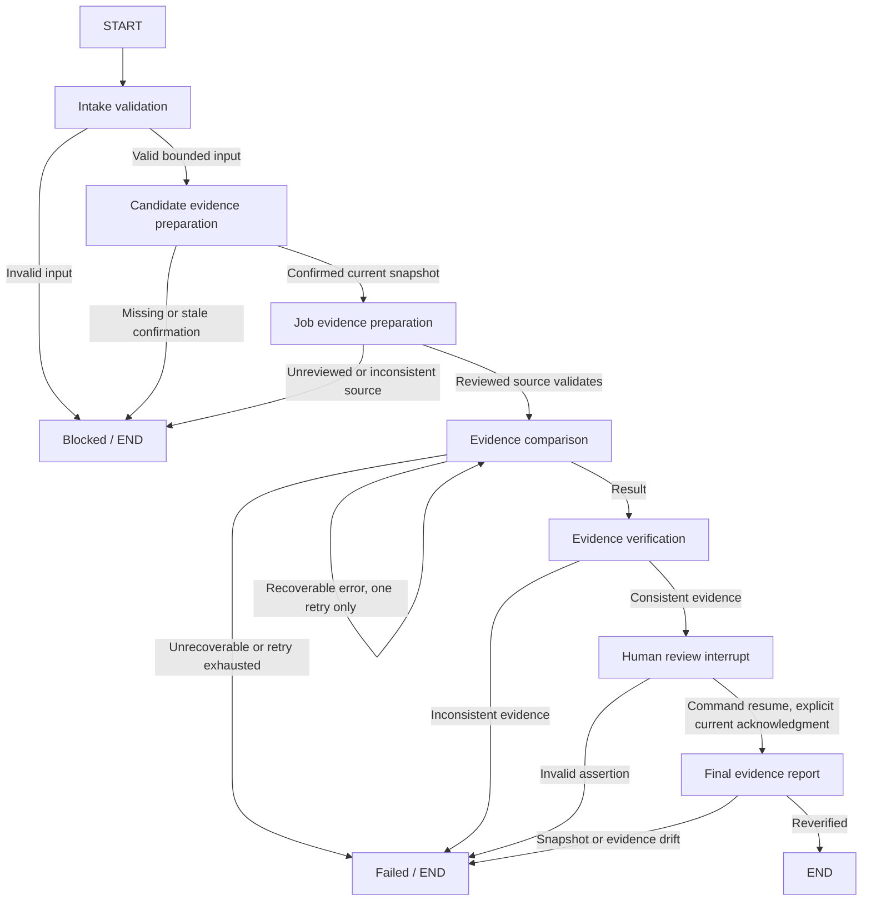

# Local LangGraph evidence workflow — Phase 5

TalentFlow AI uses **LangGraph 1.2.15** to orchestrate its existing deterministic evidence services. These nodes are bounded workflow steps, not autonomous model agents. They do not repair extraction accuracy, infer qualifications, rank candidates or make employment decisions. No API key or external model is needed.

The release was checked against [PyPI](https://pypi.org/project/langgraph/1.2.15/) on 2026-10-16. Python 3.11 is supported. Direct dependencies are pinned in `backend/requirements.txt`; `requirements.lock` was resolved in the existing Linux Python 3.11 image with every previously locked version constrained and unchanged. LangChain/LangSmith are transitive dependencies; workflow execution explicitly uses `tracing_context(enabled=False)` to prevent ambient tracing settings from exporting source text.

## Executed graph

`StateGraph(WorkflowState)` is genuinely compiled with an `InMemorySaver`. The seven node identifiers are:

1. `intake_validation`: validate existing comparison/source schemas, source constraints, qualification privacy and the immutable SHA-256 snapshot.
2. `candidate_preparation`: require candidate confirmation and equality with the reviewed qualification snapshot.
3. `job_preparation`: require job review; reuse `validate_review` and a fresh deterministic source analysis.
4. `evidence_comparison`: call the unchanged `compare_job`. Only `TimeoutError`/`ConnectionError` receive one retry; other processing errors stop immediately.
5. `evidence_verification`: check exact source text/offsets, requirement IDs/order, reviewed labels, original origin/classification, candidate paths/full fields/excerpts, duplicates and canonical technical references. Reuse `compare_requirement` to check the existing row rules rather than implement different matching semantics.
6. `human_review`: call supported `interrupt(...)`. No final report exists while the checkpoint is waiting.
7. `final_report`: after supported `Command(resume=...)`, verify the same snapshot/evidence again before completion.

The initial request runs synchronously until interruption; the UI receives the actual completed steps and waiting state. The workflow does not simulate intermediate animation or stream invented progress. Graph recursion is limited to 16 steps, each graph step has a 10-second timeout, and there are no external tools/provider calls in these nodes. Sync Python threads are not hard process isolation; this local workflow is not a sandbox for untrusted public workloads.

Cancellation and expiry are lifecycle transitions outside graph execution. They delete the checkpoint instead of resuming its nodes.

## State and source integrity

`WorkflowState` is a TypedDict containing workflow ID, browser request revision, canonical snapshot hash, minimized comparison request, comparison result, completed node identifiers, current node, human-review status, safe validation notes/errors and bounded retry count. Raw PDF bytes, credentials and uploaded files never enter graph state. The graph does not reparse PDFs.

The input is the existing `JobComparisonRequest`: six qualification collections, the original job analysis, reviewed requirement labels and both review snapshots. Candidate names, contact properties, employers, institutions, locations, dates, links and parser metadata are excluded by the existing projection/schema. The original job source and its analyzed metadata remain temporarily available because fresh analysis and exact offsets must be verifiable; this is job-source context, not candidate identity projection.

Every resume includes the **current full qualification-only comparison**, current browser revision and server snapshot hash. All must match the initial canonical SHA-256. Resume cannot replace comparison output or evidence. A changed candidate, job source, classification or requirement snapshot receives HTTP 409 without acknowledging review. Final verification also hashes the restored checkpoint request so a consistently replaced request/result cannot bypass the original snapshot.

Environment-only mentions retain `technical_environment` origin, original `unspecified` classification and `needs_review` semantics. A human label edit cannot convert context into proven mandatory qualification. Lexical technology overlap remains an unverified document mention; proficiency, duration and suitability are not inferred.

## Checkpoints and retention

Each workflow has a separate `InMemorySaver`, compiled graph, lock and entry. An application-scoped `WorkflowManager` is initialized by FastAPI lifespan; correctness does not rely on unrelated mutable module globals.

- Maximum **32 retained workflows**, including reports and safe terminal metadata. At capacity, the oldest terminal entry may be removed; if all entries are active, starting returns HTTP 429.
- Maximum workflow lifetime **30 minutes from creation**. Reads/actions enforce expiry immediately. Lifespan cleanup runs every 30 seconds, so unattended payload cleanup occurs within one additional cleanup interval.
- Waiting checkpoints can restore state only in the same backend process, before expiry/cancellation.
- Completion deletes all checkpoints and the original input, retaining the evidence comparison and safe trace for report inspection until TTL/capacity eviction.
- Blocked/failed/cancelled/expired workflows delete checkpoints and input/result payloads. Safe bounded status/hash/trace metadata can remain until eviction or shutdown.
- Shutdown clears the manager. Backend restart loses every workflow and report; this is **not durable checkpointing**.
- PostgreSQL is untouched. No candidate or graph business data is written to it.

Locks serialize start/resume/cancel for a workflow. A `client_request_id` makes retries of a start idempotent; changed documents under the same ID receive 409. Repeated or concurrent resume cannot execute the comparison/finalization twice. Report/status retrieval does not run graph nodes.

## Local access boundary

The browser generates a random 256-bit `X-Workflow-Session` capability and keeps it in React memory. The backend retains only its SHA-256 and compares it for **every** workflow action. An exposed workflow UUID is not authorization. Missing/malformed capability returns 401; unknown workflows and wrong owners both return 404. This is purpose-limited local capability scoping, **not authenticated user identity or a secure multi-user deployment**.

Agents routes reject nonlocal Host/Origin values. Existing Compose ports bind to `127.0.0.1`, and PostgreSQL is internal. Host/Origin headers and CORS alone are not authentication; preserve loopback-only deployment. Local allowed hosts include localhost, loopback addresses, Docker's host alias and `testserver` for in-process tests.

An ASGI middleware bounds the actual POST stream to **512 KiB before JSON parsing**, independently of Content-Length. Schemas forbid extra properties. Obvious contact URLs/emails/phones and protected/personal text in candidate qualification fields are rejected before any checkpoint is created. Agent schema-validation responses omit submitted input values, and responses use `Cache-Control: no-store`.

Free text cannot be proven anonymous. A name/employer embedded in a qualification description may evade these checks; inspect and remove irrelevant personal information before starting. The graph's bounded in-memory request can still contain sensitive qualification prose. No raw source text is written to execution logs or trace notes, and source text is never treated as executable instructions.

## API

All routes are under `/api/v1/agents/workflows`; all require `X-Workflow-Session` and return the same typed workflow shape on success.

| Method and suffix | Action |
| --- | --- |
| `POST /` (without trailing slash in client) | Start `{comparison, request_revision, client_request_id}`; 201 at the genuine interrupt. |
| `GET /{id}` | Read current status/safe steps and pending/final comparison when available. |
| `GET /{id}/review` | Inspect waiting evidence; 409 when not waiting, 410 after cancellation/expiry. |
| `POST /{id}/resume` | `{acknowledged:true, request_revision, snapshot_hash, comparison}`; explicit JSON boolean acknowledgment required. |
| `POST /{id}/cancel` | Cancel a pending workflow and purge it; repeat cancellation is idempotent. A completed report cannot be resumed/cancelled. |
| `GET /{id}/report` | Read a completed report without rerunning nodes; 409 before finalization, 410 after cancellation/expiry. |

Response fields include workflow ID/revision/hash, status/current node, seven actual step states, local human-review status, comparison, structured errors, static validation notes and creation/expiry timestamps. No qualification score/ranking/recommendation field is added.

Errors use `detail: {code, message}`; actual graph blocked/failed responses may additionally include `detail.workflow` with the safe executed trace. Schema failures include field locations/types without echoing input. Prerequisite/source failures return 422, stale/duplicate actions 409, cancellation/expiry actions 410, capacity 429, oversized bodies 413 and unexpected processing failure 500. `GET` status returns an explicit `expired` state, allowing the UI to explain the next action.

## React integration

`AgentSessionProvider` sits inside existing candidate/job providers and survives route navigation. It reuses Job Analysis selection, original analysis, reviewed labels and acknowledgment. Candidate selection still requires the existing separate confirmation gate; selecting an unreviewed profile never approves comparison.

The `/agents` workspace replaces Coming Soon with prerequisites, actual backend timeline, pending evidence, explicit local-review checkbox, Review & Resume, cancellation/status refresh and a final report using the existing `ComparisonResults` component. Evidence snippets, full fields, original source references and neutral technical-overview labels are reused.

An in-memory fingerprint/revision includes selected candidate, current qualification projection, confirmation, source, original analysis, reviewed requirements and job review state. Edits invalidate visible workflow evidence/acknowledgment; a waiting stale workflow is cancelled. Responses arriving after edits are discarded. Request locks prevent repeated clicks, and a retried start retains its client request ID. Refreshing/closing the page loses candidates, review state and the capability; no localStorage/sessionStorage persistence is introduced.

## Files

- `backend/app/agents/{state,schemas,errors,graph,verification,checkpoints,middleware}.py`
- `backend/app/api/routes/agents.py`, `backend/app/main.py`
- `backend/requirements.txt`, `backend/requirements.lock`
- `backend/tests/test_agents_graph.py`, `backend/tests/test_agents_api.py`
- `frontend/src/{agentTypes.ts,agentApi.ts,agentSession.tsx,agents.css}`
- `frontend/src/pages/AIAgents.tsx`, `frontend/src/App.tsx`
- `frontend/src/api.ts`, `frontend/src/test/{agents.test.tsx,agentsApi.test.ts}`
- `frontend/e2e/agents-smoke.mjs`, `frontend/e2e/Dockerfile`
- Frontend regression/browser files and actual validation results are recorded in [agent workflow testing](agent_workflow_testing.md).

See the official [interrupt/resume documentation](https://docs.langchain.com/oss/python/langgraph/interrupts) and [checkpoint documentation](https://docs.langchain.com/oss/python/langgraph/persistence). Existing CV segmentation, conservative filtering and vocabulary limitations remain; graph orchestration is not a new extraction model or a hiring-accuracy evaluation.
