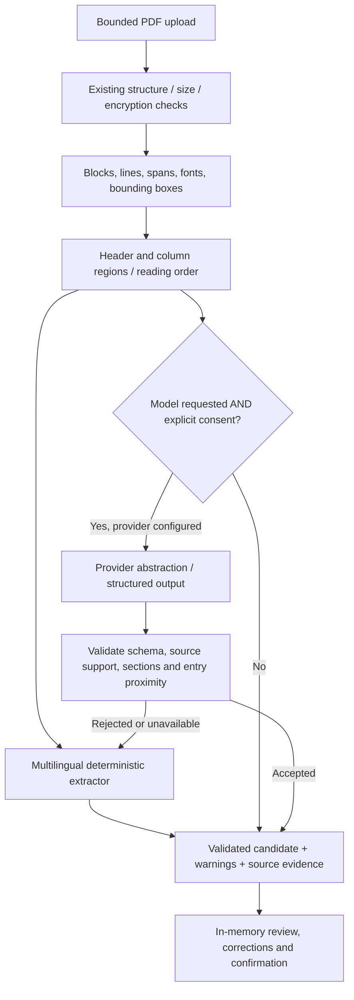

# Multilingual CV parsing — Phases 3.5 and 3.6

French and English extraction, source evidence, optional consent-gated model assistance, and human review are implemented. Processing remains local by default. Job matching, LangGraph orchestration, OCR, authentication, and database persistence are not implemented.

## Why the previous parser failed

The previous ingestion path flattened `get_text("text", sort=True)` before extraction. It discarded font and geometry information, so text from neighboring columns could interleave. Section matching was mostly English and did not normalize accents. Names/phones and structured education/experience/projects primarily required English labels. The skill dictionary and proficiency vocabulary were narrow. A selectable French PDF could therefore yield an email while omitting almost everything else; OCR would not fix these extraction rules.

## Architecture

Phase 3.6 adds entry-local association/evidence, full role and diploma subtitles, source-supported locations, French/English abbreviated months, preparatory-cycle education and wrapped/consecutive colon projects. Vocabulary adds the requested CRM/data/web/AI terms with token/URL/negative-context guards; HTML/CSS use `web_technology`. Warning summaries expand into complete grouped notes, and profile cards use natural-height columns. See [accuracy refinement and measured before/after results](cv_accuracy_refinement.md). All original consent/fallback/review/privacy boundaries remain in place.



`CandidateExtractor` remains the extraction seam. The candidate JSON shape and `POST /api/v1/candidates/parse` remain compatible. Metadata adds `evidence` and `llm_status`, and accepts engines `deterministic-v1`, `deterministic-v2`, and `llm`. The new local engine identifies itself as `deterministic-v2`; extraction still reports `partial` and never invents confidence percentages.

## Layout and languages

`layout.py` obtains PyMuPDF text dictionaries without embedded image bytes. Each line retains its source ID, page, bounding box and spans; each span retains text, font name, size and flags (including bold where encoded). Large horizontal gaps between spans can separate fragments. Header text before the first recognized section is read separately. A sufficiently supported horizontal gutter defines two column regions; full-width lines divide these into bands. Each column is read independently, with section context reset between regions. Mostly date-only right-aligned fragments are treated as row annotations instead of a second content column. Rotated text is omitted with a warning.

This supports common one-column and two-column layouts, not arbitrary magazine layouts or nested tables. Column detection is heuristic, may fail on dense or overlapping text, and emits a review warning. Headerless column continuations and unusual company-first records may remain incomplete. Unsupported layouts fail conservatively or return partial information. Structured records retain entry-local dates, descriptions and technology mentions; skills from unrelated sections are not copied into an experience.

`sections.py` is the language extension point. Accent/case/punctuation normalization is used for exact heading matching, avoiding substring matches inside ordinary prose. French aliases include Formation/Études/Parcours académique, Expériences professionnelles/Parcours professionnel, Compétences techniques/informatiques, Projets sélectionnés/Réalisations, Langues, Certifications and Profil/À propos/Résumé professionnel. English aliases remain supported. Summary sections are recognized and isolated; no new summary field or inferred candidate facts are produced from them.

Names come from explicit contact labels or a conservative first-line/header-font rule; arbitrary names in body prose are not used. Phone patterns cover common Moroccan and international forms, with schema digit/syntax validation and ambiguity warnings. Unique email and HTTP(S) GitHub/LinkedIn URLs are recognized in contact sections. Link targets hidden behind icons/annotations are not currently extracted. No demographic or protected attributes are inferred.

Unlabeled degree/role/project anchors, delimiters, local line order and date ranges supplement existing English/French labels. Common French/English month names normalize to ISO while preserving year/month precision; Aujourd’hui/Present normalize to Present. Unsupported or ambiguous dates remain missing. Mixed French labels and school-first education are supported. Entry relationships remain heuristic and require review; the extractor does not certify chronology or factual truth.

The controlled vocabulary includes the requested programming languages, frameworks/databases, data tools, RAG/GraphRAG/LLMs, knowledge graphs and model tooling. Matches are deduplicated mentions, not verified proficiency. Global skills are extracted only from skills sections. Experience/project technologies come from their own entries. GitHub profile links do not by themselves establish a GitHub skill. French and English language names are recognized while source proficiency wording (including B2 and French expressions) is retained.

## Evidence and review

Each attributed field has a dotted path, source quote, source ID, page, optional bounding box, method, and an uncertainty flag. Dates can cite their original French expression and dictionary aliases cite the actual mention. Multiline descriptions may have multiple source references. Missing or unattributed fields remain reviewable rather than receiving fabricated evidence. Font/header/layout interpretations are marked uncertain; explicit labels and dictionary mentions are attributed without implying independently verified truth.

The frontend keeps the original extraction alongside a separate reviewed profile. **Review & correct profile** opens fields for contact, education, experience, skills, projects, languages and certifications. Users can add missing information or remove an incorrect entry. Fields distinguish Extracted, Missing, Extracted · review required, and User-corrected, with expandable source quotations when available. Saving corrections clears prior confirmation. Confirmation requires a checkbox acknowledging review of fields/evidence/warnings. This stores a session-local review state; it neither persists to PostgreSQL nor runs matching. Refresh/close/clear removes session data. Original extraction warnings continue to describe the extraction, even after manual corrections.

## Optional model strategy and privacy

The provider protocol allows additional adapters; the included adapter uses the OpenAI-compatible Chat Completions structured-output format. No endpoint, model or key is hardcoded. Configure only backend runtime variables in the root ignored `.env`:

```dotenv
LLM_PROVIDER=openai-compatible
LLM_BASE_URL=
LLM_MODEL=
LLM_API_KEY=
```

Supply the actual API base URL (including its version path), a model supported by that server, and a credential. Leaving any required value unset keeps the optional provider unavailable and local parsing functional. The root `.env.example` provides empty entries. Compose passes these values only to the backend at runtime; they are excluded from image contents and never placed in Vite variables.

`GET /api/v1/candidates/extraction-config` returns public availability, provider type, destination origin, configured model and `connectivity: not_checked`; it never returns the key or calls a provider. “Configured” is not a successful connectivity check. The frontend displays the destination/model before the user opts in. Consent resets for each selected document and after success. Optional calls require multipart `use_llm=true` and `external_consent=true`; missing consent is rejected before processing. Default uploads omit both flags and make no external call. A server configured by its operator may be local or external; the frontend requests transmission consent for either.

Only extracted text/source references, not PDF files or images, are sent after opt-in. Third-party retention is governed by that provider’s policy and is stated in the consent text. Calls use a timeout, reject redirects/oversized responses, and handle rate limits, HTTP failures, refusal, invalid JSON and schema errors. The Pydantic schema is converted to a strict object schema. Nonempty fields must cite real source IDs and literal source support (or supported date/skill normalization), the correct section, and conservative entry proximity/region checks. An empty model result also falls back; valid local fields are retained when the model omits them. Unsupported fields, incorrect taxonomy or ambiguous association reject the model result and retain the local extraction with an explicit fallback warning. These checks reduce unsupported generation; textual occurrence does not prove semantic correctness or CV truthfulness. Human review remains necessary.

No paid/external model was called during validation. Provider behavior was tested with mock transports/providers, including success, timeout, rate limit, invalid output and hallucinated evidence. Live compatibility and accuracy of any configured provider/model remain unverified. Compatible servers without strict JSON-schema support fall back rather than silently weakening validation. This feature does not run LangGraph agents.

## Reproducible evaluation

The eight fictional fixtures and independently specified ground-truth profiles are in `backend/tests/fixtures/multilingual.json`. PDFs are generated in memory by `multilingual_support.py`, including geometry-controlled columns; no real CV or binary PDF is committed. Cases cover French engineering, English development, two-column content, French data analysis, missing information, unusual section order, French month dates and technical skills distributed over two columns.

Run on the host from `backend/`: `.venv/Scripts/python.exe evaluate.py`. Or from the project root:

```powershell
docker compose -f docker-compose.yml -f compose.test.yaml build backend
docker compose -f docker-compose.yml -f compose.test.yaml run --rm --no-deps backend python evaluate.py
```

Nonempty scalar values, including skill categories, are compared at field paths. Skill list order and technology-list order are not meaningful; structured record order is retained. Correct predictions divided by predictions gives micro precision; correct predictions divided by ground-truth fields gives micro recall. Exact structured-profile rate requires every normalized field to match. Skill precision/recall compare canonical name sets. Unsupported-field rate counts predicted path/value pairs absent from or differing from ground truth; this is a gold-mismatch metric, not proof of a model hallucination.

Measured on 2026-10-12, reproduced on Windows and Docker:

| Metric | Actual result |
| --- | --- |
| Field precision | 202 / 202 = 100% |
| Field recall | 202 / 202 = 100% |
| Exact structured profiles | 8 / 8 = 100% |
| Skill precision | 48 / 48 = 100% |
| Skill recall | 48 / 48 = 100% |
| Unsupported predicted fields vs ground truth | 0 / 202 = 0% |

These are development regression fixtures, not a blind holdout or representative estimate of real-world accuracy. The parser was developed against this small dataset. A larger independently authored holdout with company-first entries, tables, noisy fonts, ambiguous dates and mixed-language layouts is the recommended next phase. Do not market these fixture results as general CV parsing accuracy.

The recorded machine-readable report is [multilingual_results.json](../evaluation/multilingual_results.json). Full actual fictional French output, including evidence and warnings, is [fictional_french_output.json](../evaluation/fictional_french_output.json). An abbreviated candidate excerpt is:

```json
{
  "full_name": "Élodie Exemple",
  "email": "elodie@example.com",
  "phone": "+212 612 345 678",
  "education": [{"degree": "Master en informatique", "institution": "Université Fictive", "field_of_study": "informatique", "start_date": "2021", "end_date": "2023"}],
  "experience": [{"job_title": "Développeur backend", "company": "Atelier Fictif", "start_date": "2023-09", "end_date": "Present", "description": "API de démonstration en Python et FastAPI.", "technologies": ["Python", "FastAPI"]}],
  "languages": [{"name": "Arabe", "proficiency": "langue maternelle"}, {"name": "Français", "proficiency": "maîtrise professionnelle"}, {"name": "Anglais", "proficiency": "niveau professionnel"}]
}
```

## Validation and files

The Phase 3.5 counts below are the prior validation record. Phase 3.6 adds four authored accuracy fixtures with a captured pre-change baseline; current results, file inventory and test/browser validation are documented in [CV accuracy refinement](cv_accuracy_refinement.md). Both corpus evaluations are reproducible through `evaluate.py` (`--dataset accuracy` selects the new corpus).

Executed: 108 backend tests passed on Windows and in Docker, including all 60 original tests. One existing Starlette/httpx deprecation warning remains. All 18 frontend tests passed; strict TypeScript compilation and production builds passed. Runtime, backend/frontend test and Chromium images built successfully. Default `docker compose up -d --build` started the three services without LLM credentials. Real Chromium desktop/mobile tests uploaded English and two-column French PDFs to the actual API, checked source evidence and date/entry extraction, edited profiles, removed experience, confirmed review, navigated candidates, refreshed to verify clearing, rejected invalid PDFs and checked empty browser storage. No external model was called and no destructive Docker cleanup, commit or push was performed.

New files: `backend/app/services/{layout,sections,multilingual,llm}.py`, `backend/evaluate.py`, `backend/tests/{multilingual_support,test_multilingual,test_llm}.py`, `backend/tests/fixtures/multilingual.json`, `frontend/src/review.ts`, `frontend/src/components/ReviewProfile.tsx`, `frontend/src/test/review.test.ts`, this document and the two fictional evaluation JSON artifacts.

Modified: `backend/app/services/{pdf,extraction}.py`, `backend/app/models/candidate.py`, `backend/app/api/routes/candidates.py`, `backend/Dockerfile`, `docker-compose.yml`, `.env.example`, frontend API/types/session/parser/profile/App/styles/workflow tests/browser smoke test, README and parsing/Docker architecture documentation. Earlier Phase 3 uncommitted changes are retained.

## Remaining limits

No OCR, PDF annotation-link extraction, multilingual model accuracy guarantee, durable storage, authentication, matching or agent orchestration. Role/degree/name vocabularies are conservative; unsupported company-first, highly decorative, overlapping, multi-band or headerless layouts may omit or misassociate information. Some brief project prose may resemble a title/description; uncertainty and review are required. Short/ambiguous date forms and unsupported languages remain incomplete. Native PDF extraction is bounded by upload/page/text caps but has no hard process CPU/memory sandbox. Provider evidence checks cannot verify claimed qualifications. Chromium was tested; Firefox/Safari and assistive technology remain manual checks.

References: [PyMuPDF structured text](https://pymupdf.readthedocs.io/en/latest/app1.html), [PyMuPDF span/font and bounding-box metadata](https://pymupdf.readthedocs.io/en/latest/textpage.html), [official OpenAI structured-output format and supported schema subset](https://developers.openai.com/api/docs/guides/structured-outputs?api-mode=chat).
